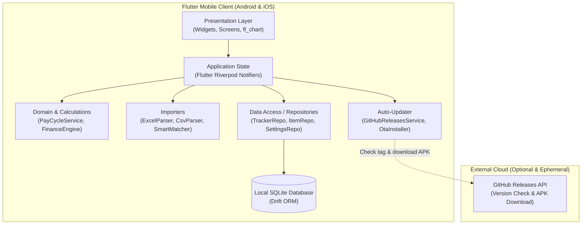
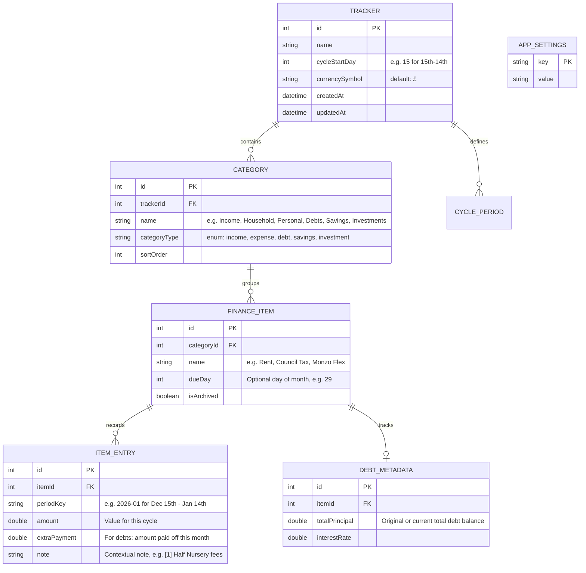
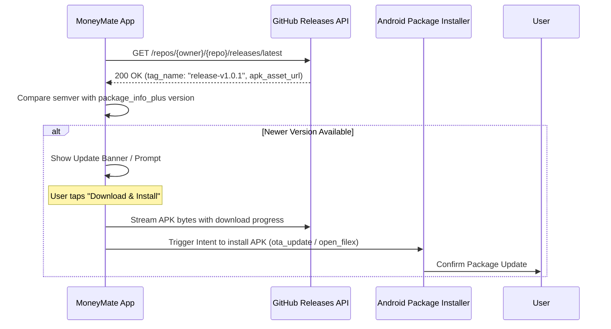

# System Architecture & Technical Specification

## MoneyMate — Personal Finance Tracker

> **Document Version:** 1.1  
> **Project Tier:** Production  
> **Status:** Approved  
> **Last Updated:** 2026-11-14  

---

## 1. System Topology

MoneyMate is architected as an **offline-first Flutter client** with local SQLite storage powered by **Drift**, with an optional lightweight GitHub Releases API integration for over-the-air client updates.



---

## 2. Directory Layout: Vertical Slice Architecture

The project adheres strictly to **Vertical Slice Architecture**, isolating each feature into a self-contained module containing its UI views, view models/state, and specific data models, while sharing foundational infrastructure via `core/`.

```text
lib/
├── core/
│   ├── constants/             # AppConstants, default categories, currency symbols (GBP £ default)
│   ├── database/              # Drift database schema, migrations, provider, and codegen
│   │   ├── app_database.dart
│   │   ├── app_database.g.dart
│   │   ├── database_provider.dart
│   │   └── tables.dart
│   ├── theme/                 # AppTheme, CraftDecorations, TactilePress, typography, spacing
│   │   ├── app_theme.dart
│   │   ├── craft_decorations.dart
│   │   └── tactile_press.dart
│   └── utils/                 # CurrencyFormatter, PayCycleService
│       ├── currency_formatter.dart
│       └── pay_cycle_service.dart
├── features/
│   ├── dashboard/             # Financial Analytics & Trend Visualisations
│   │   ├── models/            # analytics_models.dart
│   │   ├── services/          # analytics_engine_service.dart
│   │   ├── state/             # dashboard_notifier.dart
│   │   └── views/             # dashboard_screen.dart & widgets/ (KPI cards, trend chart, breakdown)
│   ├── importer/              # Excel / CSV Spreadsheet Importer
│   │   ├── models/            # import_workflow_models.dart, parsed_spreadsheet.dart, smart_match_result.dart
│   │   ├── services/          # file_picker_service.dart, smart_matcher_service.dart, spreadsheet_parser_service.dart, spreadsheet_import_commit_service.dart
│   │   ├── state/             # import_workflow_notifier.dart
│   │   └── views/             # import_spreadsheet_dialog.dart
│   ├── settings/              # Currency, Pay Cycle Start Day, Theme Mode, Categories
│   │   ├── models/            # settings_state.dart
│   │   ├── state/             # settings_notifier.dart, theme_mode_notifier.dart
│   │   └── views/             # settings_screen.dart
│   ├── shell/                 # Bottom Navigation Shell & Tab State
│   │   ├── state/             # navigation_provider.dart
│   │   └── views/             # app_shell_screen.dart
│   ├── tracker/               # Core Tracker View, Month Quick-Jump & Entry Editors
│   │   ├── models/            # tracker_ledger_models.dart
│   │   ├── state/             # tracker_ledger_notifier.dart
│   │   └── views/             # tracker_screen.dart, item_form_dialog.dart, entry_editor_dialog.dart, widgets/month_picker_sheet.dart
│   └── updater/               # In-App GitHub Releases Auto-Update
│       ├── models/            # app_release.dart
│       ├── services/          # github_release_service.dart, apk_download_service.dart
│       ├── state/             # update_notifier.dart, update_state.dart
│       └── views/             # update_prompt_dialog.dart
├── app.dart                   # MaterialApp root, theme wiring & ProviderScope configuration
└── main.dart                  # Application entry point
```

---

## 3. Database Schema & Data Models (Drift / SQLite)

### 3.1 Relational Tables



---

## 4. Business Logic & Calculation Engines

### 4.1 Pay Cycle Calculations
For a cycle start day $S$:
- When $S \le 1$, each period `(Y, M)` maps to calendar month $M$ (`1` to the last day of month $M$).
- When $S > 1$ (e.g. $S = 15$), each period `(Y, M)` is keyed by its **starting month** and spans from day $\min(S, \text{daysInMonth}(Y, M))$ of month $M$ through day $\min(S - 1, \text{daysInMonth}(\text{nextYear}, \text{nextMonth}))$ of month $M+1$.
- For example, if $S = 15$, period `2026-10` ("October 2026") spans **Oct 15, 2026 – Nov 14, 2026**.
- Transactions or entries falling within `[(Y, M, startDay), (nextYear, nextMonth, endDay)]` belong to period `(Y, M)`.

### 4.2 Financial Health Formula
For each cycle:
$$\text{Total Income} = \sum \text{Income Entries}$$
$$\text{Total Expenses} = \sum (\text{Household} + \text{Personal} + \text{Other Expenses})$$
$$\text{Total Debt Payments} = \sum \text{Debt Paid This Month}$$
$$\text{Total Savings \& Investments} = \sum (\text{Savings Put Away} + \text{Invested})$$
$$\text{Disposable Income} = \text{Total Income} - (\text{Total Expenses} + \text{Total Debt Payments} + \text{Total Savings})$$
$$\text{Remaining Debt Balance} = \text{Previous Balance} - \text{Debt Paid This Month}$$

---

## 5. In-App Auto-Update Delivery Architecture



---

## 6. Continuous Integration & Continuous Delivery Pipelines (`sdlc-ci` & `sdlc-cd`)

### 6.1 Continuous Integration: `.github/workflows/ci.yml` (`sdlc-ci`)
- **Permissions:** `contents: read` (least-privilege read-only verification).
- **Concurrency:** `group: ${{ github.workflow }}-${{ github.ref }}` with `cancel-in-progress: ${{ github.event_name == 'pull_request' }}`.
- **Trigger:** Runs on `pull_request` and `push` targeting `main`.
- **Verification Sequence (`test-and-build`):**
  1. `flutter pub get`
  2. `flutter analyze`
  3. `flutter test --reporter=expanded` (uploading `test-results.log` artefact on failure)
  4. `flutter build apk --release --build-number=${{ github.run_number }} --android-skip-build-dependency-validation` (with `GRADLE_OPTS` bounded to `-Xmx3072m -XX:MaxMetaspaceSize=768m` for 7 GB CI runners)

### 6.2 Continuous Delivery & Release: `.github/workflows/cd.yml` (`sdlc-cd`)
- **Permissions:** `contents: write`.
- **Trigger:** Runs on `push` to `main` (continuous physical device delivery), SemVer tags (`v*.*.*`), and `workflow_dispatch` (accepting a `tag` input).
- **Two-Job Artefact Handover:**
  1. **`build-release`:** Runs `flutter analyze`, `flutter test`, builds the release APK with bounded Gradle JVM memory (`-Xmx3072m`), and uploads `app-release-apk` via `actions/upload-artifact@v7`.
  2. **`release` (`needs: build-release`):** Checks out full Git history (`fetch-depth: 0`), downloads `app-release-apk` via `actions/download-artifact@v8`, extracts release notes using the 3-tier `CHANGELOG.md`-first cascade (exact tag section → `## [Unreleased]` → sanitised commit fallback preserving `hotfix:` and filtering internal commits), and publishes the GitHub Release via `softprops/action-gh-release@v3` with the `.apk` asset.

### 6.3 Required Secrets
| Secret Name | Purpose | Required For |
| :--- | :--- | :--- |
| `GITHUB_TOKEN` | Automatic GitHub-provided secret to publish GitHub Releases and upload release `.apk` assets | `release` job in `.github/workflows/cd.yml` (automatic) |
