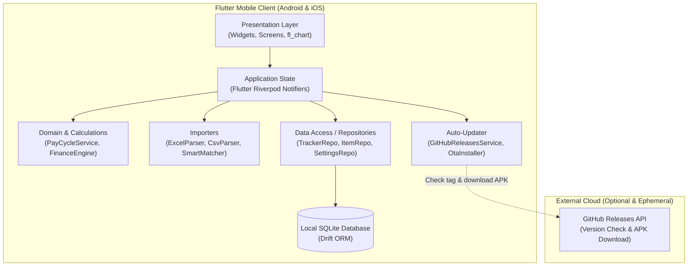
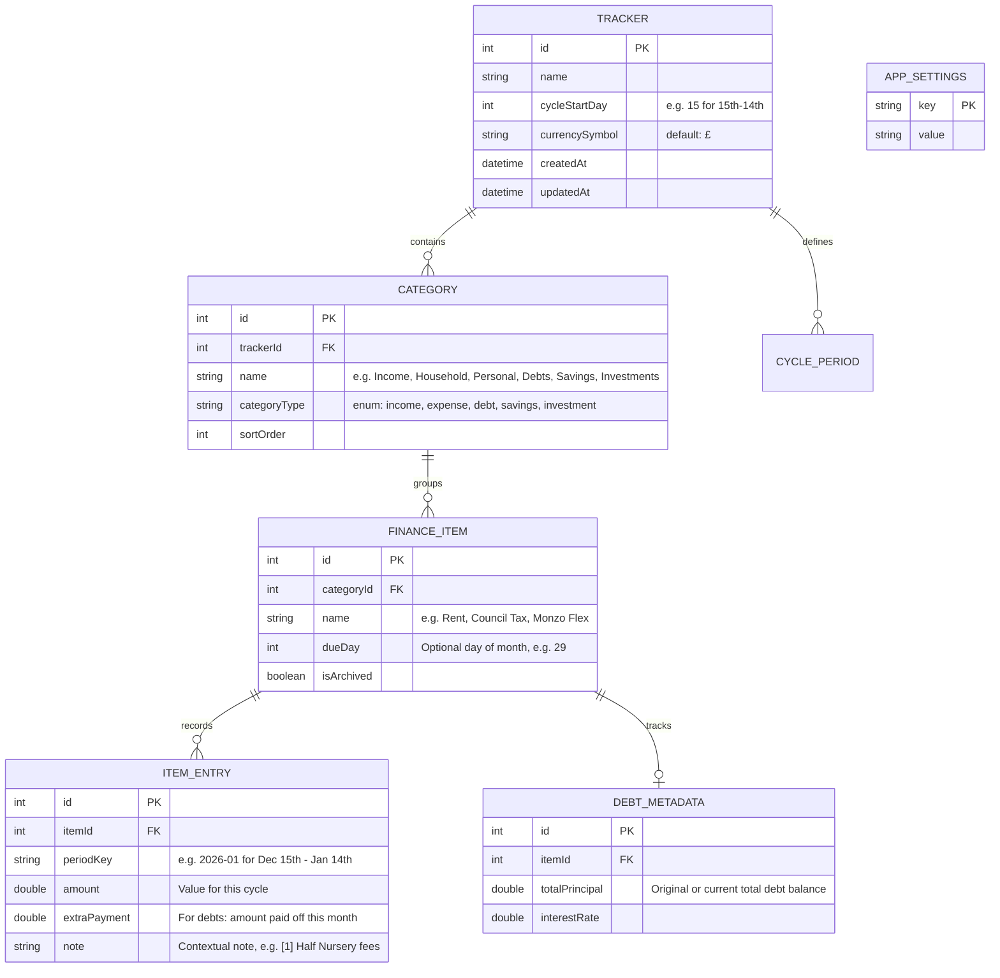
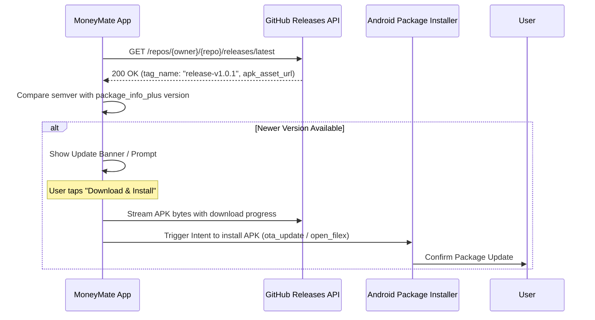

# System Architecture & Technical Specification

## MoneyMate — Personal Finance Tracker

> **Document Version:** 1.0  
> **Status:** Approved  
> **Last Updated:** 2026-10-25  

---

## 1. System Topology

MoneyMate is architected as an **offline-first Flutter client** with local SQLite storage powered by **Drift**, with an optional lightweight GitHub Releases API integration for over-the-air client updates.



---

## 2. Directory Layout: Vertical Slice Architecture

The project adheres strictly to **Vertical Slice Architecture**, isolating each feature into a self-contained module containing its UI views, view models/state, and specific data models, while sharing foundational infrastructure via `core/`.

```text
lib/
├── core/
│   ├── constants/             # App strings, default values (GBP £ default)
│   ├── database/              # Drift database tables, migrations, DAOs
│   │   ├── app_database.dart
│   │   └── tables.dart
│   ├── theme/                 # AppTheme, colors, typography, spacing
│   └── utils/                 # Currency formatters, date utilities, cycle math
├── features/
│   ├── tracker/               # Core Tracker Ledger View & Grid
│   │   ├── models/            # Tracker models, DTOs
│   │   ├── state/             # TrackerStateNotifier, Riverpod providers
│   │   └── views/             # TrackerLedgerScreen, ItemRowWidget, NoteModal
│   ├── dashboard/             # Financial Analytics & Trend Visualizations
│   │   ├── models/            # Chart series, aggregation models
│   │   ├── state/             # DashboardNotifier
│   │   └── views/             # DashboardScreen, TrendChart, CategoryBreakdown
│   ├── importer/              # Excel / CSV Spreadsheet Importer
│   │   ├── services/          # ExcelParserService, SmartMatcherService
│   │   ├── state/             # ImportWorkflowNotifier
│   │   └── views/             # FilePickerScreen, MappingPreviewScreen
│   ├── item_detail/           # Create / Edit Item, Recurring Due Day, Debts
│   │   ├── state/             # ItemDetailNotifier
│   │   └── views/             # ItemFormScreen, DebtPayoffWidget
│   ├── settings/              # Currency, Pay Cycle Start Day, Categories
│   │   ├── state/             # SettingsNotifier
│   │   └── views/             # SettingsScreen, CycleConfigWidget
│   └── updater/               # In-App GitHub Releases Auto-Update
│       ├── services/          # GitHubReleaseService, OtaUpdateService
│       ├── state/             # UpdateCheckNotifier
│       └── views/             # UpdatePromptDialog, DownloadProgressBar
└── main.dart                  # Application entry point & Riverpod ProviderScope
```

---

## 3. Database Schema & Data Models (Drift / SQLite)

### 3.1 Relational Tables



---

## 4. Business Logic & Calculation Engines

### 4.1 Pay Cycle Calculations
For a cycle start day $S$ (e.g. 15):
- A cycle labeled with month $M$ and year $Y$ spans from day $S$ of month $M-1$ through day $S-1$ of month $M$.
- For example, if $S=15$, period `2026-01` spans **Dec 15, 2025 – Jan 14, 2026**.
- Transactions or entries falling within $[(Y, M-1, S), (Y, M, S-1)]$ belong to period `(Y, M)`.

### 4.2 Financial Health Formula
For each cycle:
$$\text{Total Income} = \sum \text{Income Entries}$$
$$\text{Total Expenses} = \sum (\text{Household} + \text{Personal} + \text{Other Expenses})$$
$$\text{Total Debt Payments} = \sum \text{Debt Paid This Month}$$
$$\text{Total Savings \& Investments} = \sum (\text{Savings Put Away} + \text{Invested})$$
$$\text{Disposable Income} = \text{Total Income} - (\text{Total Expenses} + \text{Total Debt Payments} + \text{Total Savings})$$
$$\text{Remaining Debt Balance} = \text{Previous Balance} - \text{Debt Paid This Month}$$

---

## 5. In-App Auto-Update Delivery Architecture



---

## 6. Continuous Delivery Pipeline & Secrets Spec

### 6.1 GitHub Actions Workflow: `.github/workflows/ci-cd.yml`
- **Trigger:**
  - Pull Requests to `main`: Runs `test-and-build` (Analyze, Unit Tests, Build release APK).
  - Pushes to `main`: Runs `test-and-build`, followed by `deploy` to create a GitHub Release with the compiled `.apk`.
- **Artifact:** Release APK tagged as `release-v<run_number>` and labeled with commit SHA.

### 6.2 Required Secrets
| Secret Name | Purpose | Required For |
| :--- | :--- | :--- |
| `GITHUB_TOKEN` | Automatic GitHub-provided secret to create releases and upload release `.apk` assets | Deploy job (automatic) |
