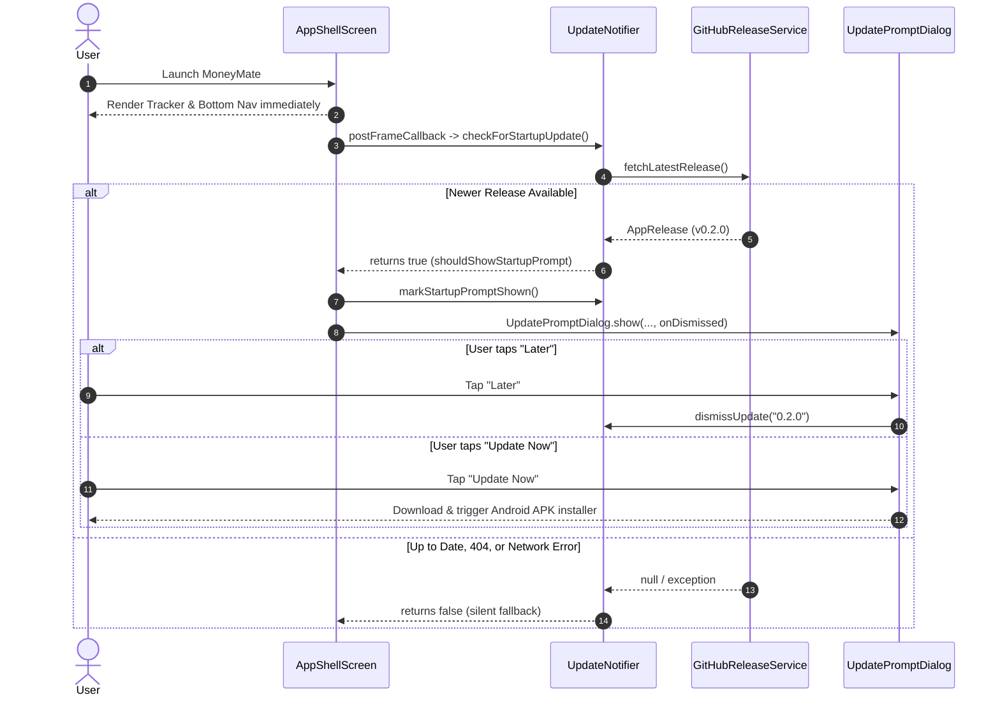

> [!WARNING]
> **TEMPORARY IN-FLIGHT ARTEFACT (`docs/FEATURE-PLAN.md`):** This document is a just-in-time (JIT) technical blueprint for the active feature slice while work is in flight. Canonical project documentation (`GEMINI.md`, `docs/PRD.md`, `docs/ARCHITECTURE.md`, `docs/ROADMAP.md`) remains locked to the current state of `main`. **Delete this file immediately upon PR merge** and run `sdlc-update-docs` to reconcile canonical documentation.

# Feature Plan: [auto-update-prompt] Automatic Startup Update Check

> **Task Slug:** `[auto-update-prompt]`  
> **Branch:** `feat/auto-update-prompt`  
> **Milestone:** Milestone 6: Post-Review UX Polish & Production Readiness  
> **Status:** Ready for Merge  
> **Created:** 2026-11-14  
> **Artefact Location:** `docs/FEATURE-PLAN.md` (temporary — delete upon PR merge)  
> **Architecture Decision Records (ADRs):** None required — aligns with Section 5 In-App Auto-Update Delivery Architecture (`docs/ARCHITECTURE.md`)

---

## 1. Objective & PRD Alignment

Deliver a non-intrusive automatic background update check on app launch that queries GitHub Releases once per session without blocking initial shell rendering, presents `UpdatePromptDialog` when a newer version is available, suppresses error popups when offline or when no releases exist, and keeps Settings up to date when the user chooses `"Later"`.

* **Linked User Story (`docs/PRD.md` US-8):** *As an active user / tester, I want to be notified when a new working vertical slice or release is published to GitHub Releases and update directly in-app, so that I always run the latest improvements without manual APK sideload downloads.*
* **Target Acceptance Scenarios (Gherkin):**
  ```gherkin
  Scenario: Automatic startup check finds a newer release
    Given the app is launching on version 0.1.0+1
    And GitHub Releases has a newer release v0.2.0 available
    When AppShellScreen finishes mounting its initial frame
    Then a single background update check runs without blocking shell navigation
    And UpdatePromptDialog appears with version 0.2.0 release notes and "Update Now" / "Later" actions
    And tapping "Later" closes the dialog and suppresses re-prompting for 0.2.0 in the current session

  Scenario: Offline launch or no published release fails silently
    Given the device has no network connectivity or GitHub Releases returns 404/500
    When AppShellScreen performs its background startup update check
    Then no error dialog or SnackBar interrupts the user
    And the Tracker screen remains interactive
    And manual "Check for updates" in Settings still surfaces descriptive feedback if tapped
  ```

---

## 2. Architecture & Tech Stack Alignment

* **Architecture Pattern:** Vertical Slice Architecture (`lib/features/updater/` + shell mount hook in `lib/features/shell/`)
* **Target Layer / Slice:** `lib/features/updater/` (`state/`, `views/`), `lib/features/shell/views/app_shell_screen.dart`, `lib/features/settings/views/settings_screen.dart`
* **State & Runtime Flow:** `flutter_riverpod` (`^3.5.0`) `Provider` + `StateNotifierProvider` (`UpdateNotifier`, `UpdateState`), scheduled post-frame via `WidgetsBinding.instance.addPostFrameCallback` on `AppShellScreen` mount.
* **Data & Storage Contract:** Ephemeral in-memory session state (`hasCheckedOnStartup`, `hasPromptedOnStartup`, `dismissedVersion`) in `UpdateState`; zero local SQLite schema changes required.
* **Verified Dependencies & Idioms (`docs/RESEARCH.md`):** Audited `2026-11-14` (within 14-day TTL): `material_ui` (`^1.11.0` — never `package:flutter/material.dart`), `flutter_riverpod` (`^3.5.0`), `package_info_plus` (`^10.2.2`), `http` (`^1.6.0`), `open_filex` (`^5.0.0`), `url_launcher` (`^6.3.3`).
* **Significant Architectural Decisions:** None — aligns with existing `GitHubReleaseService` (`EtkoMcCooty/moneymate`) and Section 5 In-App Auto-Update Delivery Architecture in `docs/ARCHITECTURE.md`.
* **Project Conventions & Safety Rules (`GEMINI.md`):** Plain everyday language in all UI labels, UK English spelling in docs/comments, `flutter analyze` zero warnings/errors, offline-safe mocked HTTP tests.

---

## 3. File Matrix (Create, Modify, Delete)

| Action | File Path | Layer / Responsibility |
| :--- | :--- | :--- |
| `[M]` | `lib/features/updater/state/update_state.dart` | Add startup check, prompt, and session dismissal tracking fields plus `shouldShowStartupPrompt` getter and `clearError` support |
| `[M]` | `lib/features/updater/state/update_notifier.dart` | Add `githubReleaseServiceProvider`, injectable `_versionProvider`, `checkForStartupUpdate()`, `markStartupPromptShown()`, and `dismissUpdate()` |
| `[M]` | `lib/features/updater/views/update_prompt_dialog.dart` | Add optional `onDismissed` callback invoked when user taps `"Later"` or `"Dismiss"` |
| `[M]` | `lib/features/shell/views/app_shell_screen.dart` | Convert to `ConsumerStatefulWidget` and run background startup check post-frame on launch |
| `[M]` | `lib/features/settings/views/settings_screen.dart` | Surface available update summary in the `"Check for updates"` subtitle when an update has been detected |
| `[C]` | `test/features/updater/auto_update_prompt_test.dart` | Unit tests for `UpdateNotifier` startup check/session debounce/silent failures and widget integration tests for `MoneyMateApp` launch prompt |

---

## 4. Classes, Functions & Interface Signatures

### 4.1 Data Models & Schemas

```dart
class UpdateState {
  final UpdateStatus status;
  final AppRelease? release;
  final String? currentVersion;
  final String? errorMessage;
  final bool hasCheckedOnStartup;
  final bool hasPromptedOnStartup;
  final String? dismissedVersion;

  bool get shouldShowStartupPrompt =>
      status == UpdateStatus.available &&
      release != null &&
      !hasPromptedOnStartup &&
      dismissedVersion != release!.version;
}
```

### 4.2 Services & Logic Functions

| File | Class / Function | Signature | Responsibility & Mutations |
| :--- | :--- | :--- | :--- |
| `lib/features/updater/state/update_notifier.dart` | `githubReleaseServiceProvider` | `Provider<GitHubReleaseService>` | Provides testable `GitHubReleaseService` instance for Riverpod overrides |
| `lib/features/updater/state/update_notifier.dart` | `UpdateNotifier.checkForStartupUpdate` | `Future<bool> checkForStartupUpdate({String? customCurrentVersion})` | Runs once per session (`hasCheckedOnStartup`), catches network/API errors silently, returns `shouldShowStartupPrompt` |

### 4.3 State, Handlers & Presentation Interfaces

| File | Component / Handler | Signature / Props / State | State Transitions & Events |
| :--- | :--- | :--- | :--- |
| `lib/features/updater/state/update_notifier.dart` | `UpdateNotifier.markStartupPromptShown` | `void markStartupPromptShown()` | Sets `hasPromptedOnStartup: true` prior to displaying dialog |
| `lib/features/updater/state/update_notifier.dart` | `UpdateNotifier.dismissUpdate` | `void dismissUpdate([String? version])` | Sets `hasPromptedOnStartup: true` and `dismissedVersion` |
| `lib/features/updater/views/update_prompt_dialog.dart` | `UpdatePromptDialog.show` | `static Future<void> show(..., {VoidCallback? onDismissed})` | Invokes `onDismissed` on `"Later"` or `"Dismiss"` tap |
| `lib/features/shell/views/app_shell_screen.dart` | `AppShellScreen` | `ConsumerStatefulWidget` | Triggers `checkForStartupUpdate()` after initial frame; opens `UpdatePromptDialog.show` if `mounted && shouldPrompt` |
| `lib/features/settings/views/settings_screen.dart` | `SettingsScreen` | `ConsumerWidget` | Displays `'Update ${version} available (Current: ${currentVersion})'` subtitle when `status == UpdateStatus.available` |

---

## 5. Step-by-Step Technical Execution

### Step 5.1: Update State & Provider Contracts
* **Target File(s):** `lib/features/updater/state/update_state.dart`, `lib/features/updater/state/update_notifier.dart`
* **Specification:**
  * Add `hasCheckedOnStartup`, `hasPromptedOnStartup`, `dismissedVersion`, `clearError`, and `shouldShowStartupPrompt` to `UpdateState`.
  * Extract `githubReleaseServiceProvider` so tests can override `GitHubReleaseService` cleanly in `ProviderScope` without live HTTP traffic.
  * Implement `checkForStartupUpdate` with a one-shot session guard (`if (state.hasCheckedOnStartup) return false;`), `markStartupPromptShown()`, and `dismissUpdate()`.
* **Edge Cases & Failure Handling:**
  * Network errors, timeouts, or 5xx responses during startup check reset status to `UpdateStatus.idle` with `clearError: true` so the user is never disturbed by offline snackbars on launch.
  * GitHub 404 (no published releases yet) transitions to `UpdateStatus.upToDate` and returns `false`.

### Step 5.2: Dialog Dismissal Callback & Shell Startup Hook
* **Target File(s):** `lib/features/updater/views/update_prompt_dialog.dart`, `lib/features/shell/views/app_shell_screen.dart`
* **Specification:**
  * Add `onDismissed` callback to `UpdatePromptDialog` and its `show()` helper, triggering when `"Later"` or `"Dismiss"` is tapped.
  * Convert `AppShellScreen` to `ConsumerStatefulWidget` and schedule `_runStartupUpdateCheck()` in `initState()` using `WidgetsBinding.instance.addPostFrameCallback`.
  * Check `mounted` before reading updated state or showing `UpdatePromptDialog`.
* **Edge Cases & Failure Handling:**
  * Guard against unmounted widget contexts after async HTTP completion (`if (!mounted || !shouldPrompt) return;`).

### Step 5.3: Settings Status Visibility
* **Target File(s):** `lib/features/settings/views/settings_screen.dart`
* **Specification:**
  * Update the `"Check for updates"` `ListTile` subtitle to indicate `'Update ${updateState.release!.version} available (Current: ${updateState.currentVersion ?? '0.1.0'})'` whenever an available release was already discovered in the background or manually.
* **Plain-Language & Usability Check:**
  * Copy remains clear, concise, and free of technical jargon (`GEMINI.md`).

---

## 6. System & Data Flow



---

## 7. Testing & TDD Verification Hooks

Conforms to test frameworks and boundaries defined in `docs/TEST-PLAN.md`:

| Test File | Test Level | Red-Phase Failure Condition | Acceptance Verification (Given / When / Then) |
| :--- | :--- | :--- | :--- |
| `test/features/updater/auto_update_prompt_test.dart` | Unit (`UpdateNotifier`) | Undefined getters/methods (`checkForStartupUpdate`, `hasCheckedOnStartup`, `shouldShowStartupPrompt`, `dismissUpdate`) | **Given** mocked `GitHubReleaseService`, **When** `checkForStartupUpdate()` runs, **Then** verifies available/upToDate/404/silent-error transitions, once-per-session guard, and dismissal state |
| `test/features/updater/auto_update_prompt_test.dart` | Widget (`MoneyMateApp` + `AppShellScreen`) | `UpdatePromptDialog` never auto-opens on startup or `githubReleaseServiceProvider` undefined | **Given** `ProviderScope` with mocked `appDatabaseProvider` & `githubReleaseServiceProvider`, **When** `MoneyMateApp` pumps on launch, **Then** auto-prompts on newer release, records dismissal on `"Later"`, and stays silent on up-to-date/offline |

---

## 8. Rollout, PR & Post-Merge Cleanup Checklist

1. **Branch Name:** `feat/auto-update-prompt`
2. **Pre-Merge Gates:**
   - [x] Red phase test confirmed failing first (`sdlc-write-tests auto-update-prompt`).
   - [x] Minimal clean code satisfies all tests (Green phase, using `sdlc-bug-hunt` on any unexpected failure).
   - [x] Full regression suite passes (100% green).
   - [x] Static analysis, typechecker, and linter pass with zero errors/warnings (`flutter analyze`).
   - [x] `docs/ROADMAP.md` marked `- [x] [auto-update-prompt]` with updated progress counter (`18 / 19`).
   - [ ] PR raised to trigger `.github/workflows/ci.yml` and audited via `sdlc-code-review`.
3. **Post-Merge Cleanup:**
   - [ ] Switched to `main`, pulled latest, and deleted `feat/auto-update-prompt`.
   - [ ] Verified CD run/deployment (`Project Tier: Production`, `.github/workflows/cd.yml`).
   - [ ] **Deleted this temporary `docs/FEATURE-PLAN.md` file.**
   - [ ] Executed `sdlc-update-docs` on `main` so canonical docs remain 100% synchronised.
