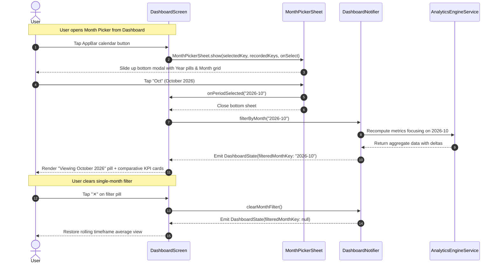

# Implementation Plan: Dashboard Month Filter & Comparative Insights

> **Target Milestone / Slice:** Milestone 6: Post-Review UX Polish & Production Readiness  
> **Target Task Slug:** `feat/dashboard-month-filter`  
> **Status:** Draft  
> **Last Updated:** 2026-11-13  
> **Artifact Location:** `docs/FEATURE-PLAN.md`  
> **Architecture Decision Records (ADRs):** None required (pure presentation and state enhancement over existing Drift tables, Riverpod `DashboardNotifier`, and `AnalyticsEngineService`).

---

## 1. Executive Summary & Objective

In the current Dashboard ("Insights") screen, users can view rolling timeframes (3 Months, 6 Months, 1 Year, All Time) and tap points on the trend chart to inspect a month's category breakdown. However:
1. There is no direct mechanism to jump to or isolate a specific historical or current pay period on the Dashboard without panning/tapping through the trend line chart.
2. KPI Overview cards do not clearly communicate whether they represent a multi-month average or a specific month, and lack comparative context (how a selected month performed relative to the timeframe average).
3. Users cannot easily reset or clear a focused period back to the full overview.

This implementation plan delivers a comprehensive **Dashboard Month Filter & Comparative Insights** feature:
1. **AppBar Quick-Jump Month Picker:** Users can tap a calendar button in the Dashboard AppBar to open the exact same `MonthPickerSheet` (year pills + 12-month grid with recorded data indicators and "Jump to today" shortcut) used in the Tracker.
2. **Active Filter Pill & One-Tap Reset:** When filtered to a specific month, an artisanal banner/pill (`"Viewing October 2026"`) appears with a dismiss (`✕`) button to immediately return to the overall timeframe average.
3. **Comparative KPI Cards:** When a single month is filtered, KPI cards show that month's exact figures accompanied by clear difference badges comparing the month against the timeframe average (e.g. `+£120 vs 6mo avg` for Disposable Income, `+4.2% vs 6mo avg` for Savings Rate).
4. **Contextual Trend Chart & Category Breakdown:** The trend chart continues to show the broader timeframe context with the selected month pinned as the active focal node, and the category breakdown reflects that specific month.

---

## 2. Architecture & Tech Stack Alignment

- **Architecture Pattern:** Vertical Slice Architecture under `lib/features/dashboard/` (models, state, services, views, widgets).
- **Target Slice:** `lib/features/dashboard/`
- **Reused Components:** `lib/features/tracker/views/widgets/month_picker_sheet.dart` (ensures 100% muscle memory and visual consistency across the app).
- **State Management:** Riverpod (`DashboardNotifier` / `dashboardNotifierProvider`).
- **Data & Storage Contract:** Drift SQLite (`AppDatabase` `itemEntries` distinct `periodKey` query).
- **Design System:** Material 3 via `package:material_ui/material_ui.dart` and `CraftDecorations`.
- **Tone & Plain Language:** Plain everyday language (e.g. "Viewing October 2026", "vs 6mo avg", "Average across 6 months"). Zero financial jargon.

---

## 3. File Matrix (Create, Modify, Delete)

| Action | File Path | Layer / Responsibility |
| :--- | :--- | :--- |
| `[M]` | `lib/features/dashboard/models/analytics_models.dart` | Add `filteredMonthKey` and `recordedPeriodKeys` to `DashboardState`. Add comparative delta calculations to `PeriodMetricSummary` / `DashboardAggregateData`. |
| `[M]` | `lib/features/dashboard/state/dashboard_notifier.dart` | Support `filterByMonth(periodKey)`, `clearMonthFilter()`, and load recorded period keys for `MonthPickerSheet`. |
| `[M]` | `lib/features/dashboard/views/widgets/dashboard_kpi_cards.dart` | Add comparative delta badges (`+£X vs avg`, `-£Y vs avg`) when a single month is filtered. |
| `[M]` | `lib/features/dashboard/views/dashboard_screen.dart` | Add AppBar calendar action button, active filter pill with `✕` clear button, and wire `MonthPickerSheet`. |
| `[C]` | `test/features/dashboard/dashboard_month_filter_test.dart` | Comprehensive unit and widget tests for month filtering, KPI comparisons, filter pill reset, and chart highlighting. |

---

## 4. Classes, Functions & Interface Signatures

### 4.1 State & Models (`analytics_models.dart`)

```dart
// In lib/features/dashboard/models/analytics_models.dart

class DashboardState {
  final AnalyticsTimeframe selectedTimeframe;
  final String? selectedPeriodKey; // Focused period on chart / breakdown
  final String? filteredMonthKey; // Explicitly set single-month filter (null if viewing timeframe average)
  final Set<String> recordedPeriodKeys; // All periods with recorded entries
  final String currencySymbol;
  final DashboardAggregateData? data;
  final bool isLoading;
  final String? errorMessage;

  bool get isMonthFiltered => filteredMonthKey != null;

  ...
}

class DashboardAggregateData {
  ...
  final double averageMonthlyIncome;
  final double averageMonthlyOutflows;
  final double averageDisposableIncome;
  final double averageSavingsRate; // NEW: Average savings rate across timeframe

  // Delta helpers for the active period vs average
  double? get disposableIncomeDelta => selectedPeriodSummary != null 
      ? selectedPeriodSummary!.disposableIncome - averageDisposableIncome 
      : null;
      
  double? get savingsRateDelta => selectedPeriodSummary != null 
      ? selectedPeriodSummary!.savingsRate - averageSavingsRate 
      : null;
}
```

### 4.2 State Notifier (`dashboard_notifier.dart`)

```dart
// In lib/features/dashboard/state/dashboard_notifier.dart

class DashboardNotifier extends StateNotifier<DashboardState> {
  ...
  /// Filters the dashboard to inspect a specific pay cycle month.
  void filterByMonth(String periodKey) {
    // If the period falls outside the current timeframe window, auto-expand timeframe if needed
    // or recalculate data with the period explicitly focused.
    final aggregateData = _recalculateData(
      timeframe: state.selectedTimeframe,
      selectedPeriodKey: periodKey,
    );

    state = state.copyWith(
      filteredMonthKey: periodKey,
      selectedPeriodKey: periodKey,
      data: aggregateData,
    );
  }

  /// Clears the single-month filter and resets to the timeframe average.
  void clearMonthFilter() {
    final aggregateData = _recalculateData(
      timeframe: state.selectedTimeframe,
      selectedPeriodKey: null,
    );

    state = DashboardState(
      selectedTimeframe: state.selectedTimeframe,
      selectedPeriodKey: null,
      filteredMonthKey: null,
      recordedPeriodKeys: state.recordedPeriodKeys,
      currencySymbol: state.currencySymbol,
      data: aggregateData,
      isLoading: false,
    );
  }
}
```

### 4.3 UI Additions (`dashboard_screen.dart` & `dashboard_kpi_cards.dart`)

1. **Dashboard AppBar Calendar Button:**
   ```dart
   IconButton(
     key: const Key('dashboard_calendar_button'),
     icon: const Icon(Icons.calendar_month_rounded),
     tooltip: 'Filter by month',
     onPressed: () => _openMonthPicker(context, ref, state),
   )
   ```

2. **Active Filter Pill Banner:**
   ```dart
   if (state.isMonthFiltered)
     Container(
       key: const Key('dashboard_active_filter_pill'),
       padding: const EdgeInsets.symmetric(horizontal: 12, vertical: 6),
       decoration: CraftDecorations.pillDecoration(context, ...),
       child: Row(
         children: [
           const Icon(Icons.filter_alt_outlined, size: 16),
           const SizedBox(width: 6),
           Text('Viewing ${PayCycleService.formatPeriodTitle(state.filteredMonthKey!)}'),
           const Spacer(),
           IconButton(
             key: const Key('dashboard_clear_filter_button'),
             icon: const Icon(Icons.close_rounded, size: 16),
             onPressed: () => ref.read(dashboardNotifierProvider.notifier).clearMonthFilter(),
           ),
         ],
       ),
     )
   ```

3. **KPI Card Comparative Badges:**
   When `state.isMonthFiltered == true`, render a badge on the hero card:
   - Disposable Income: `+£120 vs 6mo avg` (green) or `-£80 vs 6mo avg` (red).
   - Label: displays `October 2026` instead of `Average`.

---

## 5. System & Data Flow



---

## 6. Testing & Verification Hooks

| Test File | Test Case | Acceptance Verification (Given / When / Then) |
| :--- | :--- | :--- |
| `test/features/dashboard/dashboard_month_filter_test.dart` | AppBar calendar button opens MonthPickerSheet | **Given** Dashboard loaded with data, **When** calendar button tapped, **Then** `MonthPickerSheet` opens. |
| `test/features/dashboard/dashboard_month_filter_test.dart` | Selecting month activates filter | **Given** `MonthPickerSheet` open, **When** user selects "Oct 2026", **Then** sheet closes, active filter pill appears, and KPIs show Oct 2026. |
| `test/features/dashboard/dashboard_month_filter_test.dart` | KPI comparative deltas | **Given** Oct 2026 selected, **When** KPI cards render, **Then** comparative delta vs timeframe average is displayed. |
| `test/features/dashboard/dashboard_month_filter_test.dart` | Clear filter button resets view | **Given** active filter pill visible, **When** "✕" button tapped, **Then** filter pill disappears and KPIs return to timeframe average. |
| `test/features/dashboard/dashboard_month_filter_test.dart` | Timeframe chip switch clears filter | **Given** active single-month filter, **When** user taps a different timeframe chip (e.g. 1 Year), **Then** single-month filter is cleared. |

---

## 7. Rollout & Pull Request Strategy

1. **Branch Name:** `feat/dashboard-month-filter`
2. **Quality & Verification Gates:**
   - Execute `flutter test test/features/dashboard/dashboard_month_filter_test.dart`.
   - Run full regression suite (`flutter test`, all 135+ tests).
   - Static analysis gate (`dart analyze --fatal-infos`, 0 issues).
3. **Commit & PR:**
   - Conventional commit: `feat(dashboard): add month filter picker, active filter pill, and comparative KPI cards`
   - Raise Pull Request via GitHub MCP tool.