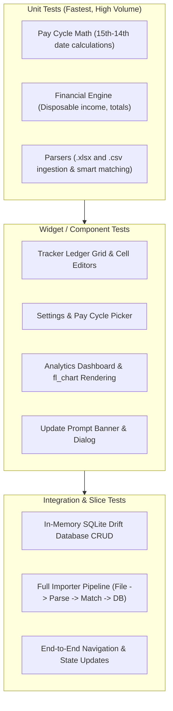

# Testing Strategy & Quality Assurance Plan

## MoneyMate — Personal Finance Tracker

> **Document Version:** 1.0  
> **Status:** Active  
> **Last Updated:** 2026-10-25  

---

## 1. Quality Objectives & Testing Philosophy
MoneyMate manages sensitive personal financial data. Calculation errors or corrupted imports can result in broken financial ledgers. To ensure total correctness and reliability:
- **Test-Driven Development (TDD):** Business logic, pay-cycle formulas, and spreadsheet parsers are authored using strict Red-Green-Refactor cycles.
- **Offline Reliability:** Tests must execute 100% locally with zero external network dependencies (Drift SQLite runs in an in-memory test database).
- **Fast Execution:** Unit and widget test suites must complete within seconds to maintain snappy developer feedback loops.

---

## 2. Testing Levels & Boundaries



### 2.1 Unit Tests (`test/unit/` or co-located under `test/features/`)
- **Domain Calculations:** Validate that pay cycle start offsets (e.g. 15th to 14th) accurately bucket transactions across leap years, month-end boundary variations, and non-calendar cycles.
- **Financial Math:** Verify totals, debt balance countdown, and disposable income formulas:
  $$\text{Disposable Income} = \text{Total Income} - (\text{Expenses} + \text{Debt Payments} + \text{Savings})$$
- **Spreadsheet Parsers:** Test `.xlsx` and `.csv` decoding against realistic fixture files containing empty rows, currency symbols (£, $, €), and custom category naming.

### 2.2 Widget & Component Tests (`test/features/<slice>/views/`)
- Utilize Flutter's `testWidgets` with `WidgetTester`.
- Test user interactions (entering values, toggling sections, opening notes).
- Ensure accessible touch targets (minimum 48x48dp) and semantic labels.
- Verify reactive UI updates when Riverpod state mutates.

### 2.3 Integration Tests & Database Layer (`test/core/database/`)
- Test SQLite Drift DAOs using an in-memory SQLite database (`NativeDatabase.memory()`).
- Verify transactions, cascade deletes, and relational integrity between Trackers, Categories, Items, and Entries.

---

## 3. Test Directory Structure

```text
test/
├── core/
│   ├── database/              # Drift in-memory database CRUD & DAO tests
│   └── utils/                 # Currency formatting & date math unit tests
├── features/
│   ├── tracker/               # Ledger grid, item CRUD & entry editor tests
│   ├── settings/              # Pay cycle engine & settings notifier tests
│   ├── importer/              # Excel & CSV parser + smart matcher tests
│   ├── dashboard/             # Aggregation engine & chart widget tests
│   └── updater/               # GitHub Releases semver & update dialog tests
├── fixtures/                  # Sample .xlsx and .csv spreadsheets for importer tests
└── smoke_test.dart            # Baseline CI/CD test harness validation
```

---

## 4. Mocking & Isolation Strategy
- **External Network Calls:** The GitHub Releases updater API must be mocked via an HTTP client adapter (`MockClient`) in all test environments.
- **Database Isolation:** Drift tests must never touch the physical device file system; use `NativeDatabase.memory()`.
- **Clock & Time:** Use `fake_async` or clock injection when verifying time-sensitive pay-cycle transitions.

---

## 5. Coverage Targets & Gate Policies

| Layer / Module | Target Coverage | Enforcement |
| :--- | :--- | :--- |
| **Domain Logic & Math** (`pay_cycle`, `finance_engine`) | $\ge 90\%$ | Strictly enforced in PR reviews |
| **Spreadsheet Parsers** (`excel`, `csv`, `smart_matcher`) | $\ge 85\%$ | Verified against multi-format test fixtures |
| **Drift DAOs & Database** | $\ge 80\%$ | In-memory integration suite |
| **UI Widgets & Screens** | $\ge 70\%$ | Component & interaction tests |

---

## 6. Execution Commands

```bash
# Run all tests
flutter test

# Run a specific test file
flutter test test/features/settings/pay_cycle_engine_test.dart

# Run tests with coverage output
flutter test --coverage

# Run static analysis
flutter analyze
```
