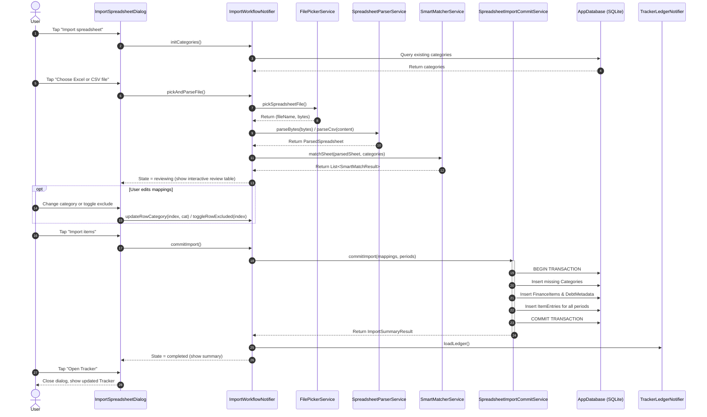

# Implementation Plan: Milestone 4 — Spreadsheet Importer Slice (End-to-End)

> **Target Milestone:** Milestone 4: Spreadsheet Importer Slice (Excel & CSV - End-to-End)  
> **Target Task Slug:** `importer-ui-flow`  
> **Status:** Ready for Implementation  
> **Last Updated:** 2026-11-04  
> **Artifact Location:** `docs/plans/milestone-4-plan.md`

---

## 1. Executive Summary & Objective

This implementation plan delivers the final user-facing piece of Milestone 4: the **Spreadsheet Importer Flow & Review UI (`importer-ui-flow`)**. Building on the existing multi-month spreadsheet parsers (`SpreadsheetParserService`) and heuristic categorization engine (`SmartMatcherService`), this slice connects file selection on mobile/desktop, an interactive pre-import category and due-date review modal, and an atomic database transaction that persists all parsed items, recurring dates, and monthly entries directly into MoneyMate's local Drift SQLite database.

Upon completion, users will be able to tap "Import spreadsheet", pick any `.xlsx` or `.csv` budget spreadsheet, visually review and adjust matched categories and recurring due dates, and import years or months of past finances in one tap with zero data corruption.

---

## 2. Architecture & Tech Stack Alignment

- **Architecture Pattern:** Vertical Slice Architecture under `lib/features/importer/` (models, services, state, views) with foundation access to `lib/core/database/`.
- **Target Slice:** `lib/features/importer/`
- **State Management:** Riverpod (`StateNotifier<ImportWorkflowState>`) managing the multi-step import lifecycle (file picking, parsing, review/edit, atomic commit, and completion).
- **Storage / Database:** Drift ORM (`AppDatabase`) executing a single atomic transaction across `Trackers`, `Categories`, `FinanceItems`, `DebtMetadata`, and `ItemEntries`.
- **External Dependencies:**
  - `file_picker` (^10.0.0 or latest compatible) for cross-platform file selection.
  - Existing packages: `excel` (^4.0.6), `csv` (^8.0.0), `drift` (^2.35.3), `flutter_riverpod` (^3.4.3).
- **Plain-Language UX Enforcement:** Strict compliance with `GEMINI.md`. All dialog copy, tooltips, and progress indicators must use plain, friendly language (e.g., "Import spreadsheet", "Pick file", "Review items & categories", "Adding your items...", "Import complete"). Zero financial or database jargon (no "ledger", "batch commit", "offset", "amortization").

---

## 3. File Matrix (Create, Modify, Delete)

| Action | File Path | Layer / Responsibility |
| :--- | :--- | :--- |
| `[M]` | `pubspec.yaml` | Add `file_picker` dependency |
| `[C]` | `lib/features/importer/models/import_workflow_models.dart` | Models for editable row mapping, import state, and summary |
| `[C]` | `lib/features/importer/services/file_picker_service.dart` | Abstraction wrapper for selecting `.xlsx` and `.csv` files (allows seamless mock testing) |
| `[C]` | `lib/features/importer/services/spreadsheet_import_commit_service.dart` | Atomic Drift database transaction inserting trackers, categories, items, and entries |
| `[C]` | `lib/features/importer/state/import_workflow_notifier.dart` | Riverpod StateNotifier coordinating file picking, parsing, mapping adjustments, and DB commit |
| `[M]` | `lib/features/importer/views/import_spreadsheet_dialog.dart` | Replace placeholder dialog with interactive file picker, category review table, and progress states |
| `[C]` | `test/features/importer/spreadsheet_import_commit_service_test.dart` | Unit tests for atomic Drift database transactions, category creation, and deduplication |
| `[C]` | `test/features/importer/import_workflow_notifier_test.dart` | Unit tests for state transitions, category override mutations, and error handling |
| `[C]` | `test/features/importer/import_spreadsheet_dialog_test.dart` | Widget tests verifying file picker invocation, review modal table rendering, and import button tap |

---

## 4. Classes, Functions & Interface Signatures

### 4.1 Data Models & Schemas (`lib/features/importer/models/import_workflow_models.dart`)

```dart
/// Represents an editable line item row during the pre-import review stage.
class ImportRowMapping {
  final int rowIndex;
  final String originalLabel;
  final String cleanName;
  final int? dueDay;
  final String targetCategoryName;
  final String targetCategoryType; // income, expense, debt, savings, investment
  final int? targetCategoryId;
  final bool isDebt;
  final bool isExcluded;
  final bool isAmbiguous;
  final Map<String, ParsedCell> periodValues;

  const ImportRowMapping({
    required this.rowIndex,
    required this.originalLabel,
    required this.cleanName,
    this.dueDay,
    required this.targetCategoryName,
    required this.targetCategoryType,
    this.targetCategoryId,
    this.isDebt = false,
    this.isExcluded = false,
    this.isAmbiguous = false,
    required this.periodValues,
  });

  ImportRowMapping copyWith({
    String? cleanName,
    int? dueDay,
    String? targetCategoryName,
    String? targetCategoryType,
    int? targetCategoryId,
    bool? isDebt,
    bool? isExcluded,
  });
}

/// Status of the active import workflow.
enum ImportStep {
  idle,
  pickingFile,
  parsing,
  reviewing,
  committing,
  completed,
  error,
}

/// Summary of persisted items and values following commit.
class ImportSummaryResult {
  final int itemsCount;
  final int entriesCount;
  final int categoriesCount;
  final List<String> periodKeys;

  const ImportSummaryResult({
    required this.itemsCount,
    required this.entriesCount,
    required this.categoriesCount,
    required this.periodKeys,
  });
}

/// State for the ImportWorkflowNotifier.
class ImportWorkflowState {
  final ImportStep step;
  final String? fileName;
  final Uint8List? fileBytes;
  final ParsedSpreadsheet? parsedSpreadsheet;
  final int selectedSheetIndex;
  final List<ImportRowMapping> mappings;
  final List<AvailableCategory> availableCategories;
  final String? errorMessage;
  final ImportSummaryResult? summary;

  const ImportWorkflowState({
    this.step = ImportStep.idle,
    this.fileName,
    this.fileBytes,
    this.parsedSpreadsheet,
    this.selectedSheetIndex = 0,
    this.mappings = const [],
    this.availableCategories = const [],
    this.errorMessage,
    this.summary,
  });

  ImportWorkflowState copyWith({ ... });
}
```

### 4.2 Services & Logic Functions

#### `FilePickerService` (`lib/features/importer/services/file_picker_service.dart`)
| Method Signature | Responsibility |
| :--- | :--- |
| `Future<PickedSpreadsheetFile?> pickSpreadsheetFile()` | Opens device file picker for `['xlsx', 'csv']`, reading filename and bytes. Returns null if canceled. |

#### `SpreadsheetImportCommitService` (`lib/features/importer/services/spreadsheet_import_commit_service.dart`)
| Method Signature | Responsibility |
| :--- | :--- |
| `Future<ImportSummaryResult> commitImport({required int trackerId, required List<ImportRowMapping> mappings, required List<ParsedPeriodHeader> periodHeaders})` | Executes atomic `_db.transaction`: ensures categories exist, creates/updates `FinanceItems` with `dueDay`, creates `DebtMetadata` if debt, and inserts `ItemEntries` for all monthly columns. Returns summary metrics. |

### 4.3 State, Handlers & Presentation Interfaces

#### `ImportWorkflowNotifier` (`lib/features/importer/state/import_workflow_notifier.dart`)
| Method Signature | Responsibility & State Mutation |
| :--- | :--- |
| `Future<void> initCategories()` | Queries DB for existing categories and populates `availableCategories`. |
| `Future<void> pickAndParseFile()` | Triggers `FilePickerService`, parses bytes via `SpreadsheetParserService`, classifies rows via `SmartMatcherService`, sets `step = ImportStep.reviewing`. |
| `void updateRowCategory(int rowIndex, AvailableCategory category)` | Updates `targetCategoryName`, `targetCategoryId`, and `targetCategoryType` for a row. |
| `void updateRowDueDay(int rowIndex, int? dueDay)` | Adjusts or clears the recurring due day for a row. |
| `void toggleRowExcluded(int rowIndex)` | Toggles `isExcluded` so the row is omitted during DB commit. |
| `void selectSheet(int sheetIndex)` | Switches active sheet in multi-sheet Excel workbooks and re-runs matcher. |
| `Future<bool> commitImport()` | Calls `SpreadsheetImportCommitService`, transitions to `committing` then `completed`, and notifies `TrackerLedgerNotifier.loadLedger()`. |
| `void reset()` | Resets state to `ImportStep.idle`. |

---

## 5. Step-by-Step Technical Execution

### Step 5.1: Dependency & File Picker Abstraction
- **Target File:** `pubspec.yaml`, `lib/features/importer/services/file_picker_service.dart`
- **Specification:**
  - Add `file_picker: ^10.0.0` (or latest compatible) to `pubspec.yaml`.
  - Implement `FilePickerService` with a clean `pickSpreadsheetFile()` method returning `(String name, Uint8List bytes)?`.
  - Expose via `filePickerServiceProvider` for dependency injection and mock testing.
- **Edge Cases & Failure Handling:**
  - User cancels file picker dialog $\rightarrow$ gracefully retain current state without errors.
  - Unsupported file extension selected $\rightarrow$ return friendly error: "Please choose an Excel (.xlsx) or CSV file."

### Step 5.2: Ingestion & Review State Notifier
- **Target File:** `lib/features/importer/models/import_workflow_models.dart`, `lib/features/importer/state/import_workflow_notifier.dart`
- **Specification:**
  - Convert `ParsedSheet` rows and `SmartMatchResult` list into mutable `List<ImportRowMapping>`.
  - Detect ambiguous category matches (`confidence < 0.7`) and flag them with `isAmbiguous = true`.
  - Expose mutation methods for user edits (`updateRowCategory`, `updateRowDueDay`, `toggleRowExcluded`).
- **Edge Cases & Failure Handling:**
  - Empty spreadsheet or sheet with no valid data $\rightarrow$ display friendly message: "No spending rows found in this file."
  - Multiple sheets in Excel $\rightarrow$ provide sheet tab/dropdown selection.

### Step 5.3: Atomic Drift Database Transaction Service
- **Target File:** `lib/features/importer/services/spreadsheet_import_commit_service.dart`
- **Specification:**
  - Run all database operations inside `_db.transaction(() async { ... })`.
  - Step A: Verify tracker exists; use active tracker ID.
  - Step B: Create a category cache (`Map<String, int>`). If a mapped category does not exist, insert it into `CategoriesCompanion` with appropriate `categoryType` and `sortOrder`.
  - Step C: For each non-excluded `ImportRowMapping`:
    - Insert `FinanceItemsCompanion` (`name`, `categoryId`, `dueDay`).
    - If `isDebt`, insert `DebtMetadataCompanion` with default principal.
    - For each period header, check if an amount exists in `row.periodValues[period.rawHeader]`.
    - If valid numeric amount exists, insert `ItemEntriesCompanion` (`itemId`, `periodKey: period.normalizedKey`, `amount`, `note`).
- **Edge Cases & Failure Handling:**
  - Foreign key integrity $\rightarrow$ ensure `PRAGMA foreign_keys = ON;` is respected.
  - Any SQLite exception $\rightarrow$ full transaction rollback, state transitions to `ImportStep.error`, and zero partial rows saved.

### Step 5.4: Interactive Pre-Import Preview & Review Modal UI
- **Target File:** `lib/features/importer/views/import_spreadsheet_dialog.dart`
- **Specification:**
  - Replace static placeholder with reactive multi-state view:
    - **State 1 (Idle / Pick):** Clean card explaining Excel/CSV import, with a primary "Choose file" button.
    - **State 2 (Parsing / Loading):** Friendly spinner: "Reading your spreadsheet...".
    - **State 3 (Review Modal):**
      - Header: File name, detected month count (e.g. "3 months of entries found: Jan 2026 – Mar 2026").
      - Scrollable review table with rows showing:
        - Checkbox (include/exclude)
        - Clean item name & due day badge (e.g., "Rent (29th)")
        - Category selector chip/dropdown (Household, Income, Personal, Debts, Savings)
        - Ambiguous match warning icon (if confidence is low, prompting user check)
      - Actions: "Cancel" and "Import X items" filled button.
    - **State 4 (Committing):** "Adding items to your tracker...".
    - **State 5 (Completed):** Success checkmark, summary ("Added 14 items across 3 months"), and "Open Tracker" button.
- **Project Voice & Usability Check:**
  - Zero jargon. Friendly plain English strings.

### Step 5.5: Ledger Reload Wiring
- **Target File:** `lib/features/importer/views/import_spreadsheet_dialog.dart`, `lib/features/tracker/views/tracker_screen.dart`
- **Specification:**
  - Upon successful commit, call `ref.read(trackerLedgerProvider.notifier).loadLedger()` so the ledger immediately populates with the imported items and disposable income figures without requiring app restart.

---

## 6. System & Data Flow



---

## 7. Testing & TDD Verification Hooks

| Task Slug | Test File | Test Level | Acceptance Verification (Given / When / Then) |
| :--- | :--- | :--- | :--- |
| `importer-ui-flow` | `test/features/importer/spreadsheet_import_commit_service_test.dart` | Unit / Logic | **Given** an in-memory `AppDatabase` and 3 mapped rows across 2 periods, **When** `commitImport()` is executed, **Then** all categories, items, and entries are persisted in Drift and foreign keys match. |
| `importer-ui-flow` | `test/features/importer/spreadsheet_import_commit_service_test.dart` | Unit / Transaction | **Given** a commit operation that fails midway (simulated error), **When** transaction runs, **Then** entire batch is rolled back and zero partial rows remain. |
| `importer-ui-flow` | `test/features/importer/import_workflow_notifier_test.dart` | Unit / State | **Given** mock parser and matcher, **When** `pickAndParseFile()` succeeds, **Then** state transitions from `idle` to `reviewing` with correct row mappings. |
| `importer-ui-flow` | `test/features/importer/import_workflow_notifier_test.dart` | Unit / State | **Given** reviewing state, **When** `updateRowCategory()` is invoked, **Then** row category is updated and marked non-ambiguous. |
| `importer-ui-flow` | `test/features/importer/import_spreadsheet_dialog_test.dart` | Widget / UI | **Given** dialog opened in review state, **When** user taps category dropdown, **Then** available categories are shown and user can select a new category. |
| `importer-ui-flow` | `test/features/importer/import_spreadsheet_dialog_test.dart` | Widget / UI | **Given** dialog in completed state, **When** user taps "Open Tracker", **Then** dialog closes and ledger reloads. |

---

## 8. Rollout & Pull Request Strategy

1. **Branch Name:** `feat/importer-ui-flow`
2. **Review Criteria:**
   - [ ] Red phase test confirmed failing first (`sdlc-write-tests importer-ui-flow`).
   - [ ] Minimal clean code satisfies all unit and widget tests (Green phase).
   - [ ] Full regression suite passes (`flutter test`).
   - [ ] Static analysis passes with zero warnings (`flutter analyze`).
   - [ ] `docs/ROADMAP.md` updated to mark Milestone 4 complete (11/14 tasks, 79%).
   - [ ] PR created and audited via `sdlc-code-review` before merge.
