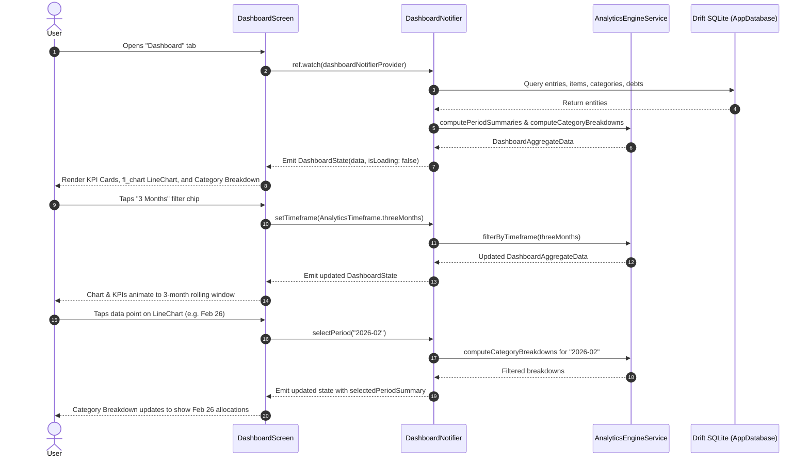

# Implementation Plan: Milestone 5 — Interactive Analytics Dashboard Slice (End-to-End)

> **Target Milestone:** Milestone 5: Interactive Analytics Dashboard Slice (End-to-End)  
> **Target Tasks / Slugs:** `[dashboard-analytics-engine]`, `[dashboard-charts-ui]`  
> **Status:** Ready for Implementation  
> **Last Updated:** 2026-11-05  
> **Artifact Location:** `docs/plans/milestone-5-plan.md`  

---

## 1. Executive Summary & Objective

This implementation plan delivers **Milestone 5: Interactive Analytics Dashboard Slice (End-to-End)** for MoneyMate. Building upon the Drift SQLite database foundation, the custom pay cycle engine, and the spreadsheet importer delivered in Milestones 1–4, Milestone 5 equips users with a responsive, offline-first financial intelligence dashboard.

Users will be able to:
1. Examine their overall financial health at a glance (Income, Outflows, Savings Rate, Debt Payoff, and Disposable Income).
2. Filter across multiple rolling time horizons: **Last 3 Months (3M)**, **Last 6 Months (6M)**, **Last Year (1Y)**, and **All Time**.
3. Interact with dynamic multi-series trend charts (powered by `fl_chart`) comparing **Income vs. Outflows vs. Disposable Income**.
4. Tap any period or chart point to inspect a clean breakdown of category spending ("Where your money goes") with zero financial jargon.

---

## 2. Architecture & Tech Stack Alignment

- **Architecture Pattern:** Vertical Slice Architecture under `lib/features/dashboard/` (models, services, state, views) reading data from the central Drift SQLite database via `AppDatabase`.
- **Target Slice:** `lib/features/dashboard/`
  - `models/`: Immutable aggregation models, timeframe enums, KPI metrics, and view states.
  - `services/`: Pure Dart domain service (`AnalyticsEngineService`) computing rolling period windows, disposable income, savings rates, debt countdown, and category allocations.
  - `state/`: Riverpod `StateNotifier<DashboardState>` orchestrating database queries, timeframe switches, and drill-down selections.
  - `views/`: `DashboardScreen`, `DashboardTimeframeChips`, `DashboardKpiCards`, `DashboardTrendChart`, and `CategoryBreakdownSection`.
- **State Management:** Riverpod (`StateNotifierProvider<DashboardNotifier, DashboardState>`).
- **Storage / Database Contract:** Drift ORM (`AppDatabase`) querying `Trackers`, `Categories`, `FinanceItems`, `DebtMetadata`, and `ItemEntries`.
- **External Dependencies:**
  - `fl_chart` (`^1.3.0`): Interactive line charts, touch tooltips, and custom indicator markers.
  - Existing packages: `flutter_riverpod`, `drift`, `intl`.
- **Project Guidelines & Plain Language Enforcement (`GEMINI.md`):**
  - **Zero Jargon:** No words like *"Ledger"*, *"Historical Trends"*, *"Amortization"*, or *"Disposition"*.
  - **Approved Terminology:** *"Insights"*, *"Your Progress"*, *"Disposable Income"* (approved spreadsheet standard), *"Bills & Expenses"*, *"Where your money goes"*, *"Pay Period"*.
  - **Default Currency:** British Pound Sterling (£ / GBP) formatted via `CurrencyFormatter`.

---

## 3. File Matrix (Create, Modify, Delete)

| Action | File Path | Layer / Responsibility |
| :--- | :--- | :--- |
| `[M]` | `pubspec.yaml` | Add `fl_chart: ^1.3.0` dependency |
| `[C]` | `lib/features/dashboard/models/analytics_models.dart` | Immutable domain models: `AnalyticsTimeframe`, `PeriodMetricSummary`, `CategoryMetricBreakdown`, `DashboardAggregateData`, and `DashboardState` |
| `[C]` | `lib/features/dashboard/services/analytics_engine_service.dart` | Pure domain calculation service: timeframe windowing, rolling summaries, category breakdowns, averages, and debt countdown |
| `[C]` | `lib/features/dashboard/state/dashboard_notifier.dart` | Riverpod `DashboardNotifier` querying Drift and publishing reactive `DashboardState` |
| `[M]` | `lib/features/dashboard/views/dashboard_screen.dart` | Transform placeholder into rich, scrollable dashboard with KPI cards, timeframe chips, interactive charts, and category breakdown |
| `[C]` | `lib/features/dashboard/views/widgets/dashboard_kpi_cards.dart` | Metric cards for Disposable Income, Income vs Outflows, Savings Rate, and Total Debt |
| `[C]` | `lib/features/dashboard/views/widgets/dashboard_trend_chart.dart` | Interactive `fl_chart` line chart with Income, Outflows, and Disposable Income lines and touch tooltips |
| `[C]` | `lib/features/dashboard/views/widgets/category_breakdown_section.dart` | Category allocation card with percentage bars and color-coded labels |
| `[C]` | `test/features/dashboard/analytics_engine_service_test.dart` | Unit tests for aggregation math, timeframe windows (3M, 6M, 1Y, all-time), disposable income, and empty/zero edge cases |
| `[C]` | `test/features/dashboard/dashboard_notifier_test.dart` | Unit tests for state transitions, database querying, timeframe filtering, and period selection |
| `[C]` | `test/features/dashboard/dashboard_screen_test.dart` | Widget tests verifying empty states, KPI cards, timeframe toggle chips, and chart interaction |

---

## 4. Classes, Functions & Interface Signatures

### 4.1 Data Models (`lib/features/dashboard/models/analytics_models.dart`)

```dart
/// Supported rolling timeframe filters for analytics.
enum AnalyticsTimeframe {
  threeMonths,
  sixMonths,
  oneYear,
  allTime;

  String get label => switch (this) {
        AnalyticsTimeframe.threeMonths => '3 Months',
        AnalyticsTimeframe.sixMonths => '6 Months',
        AnalyticsTimeframe.oneYear => '1 Year',
        AnalyticsTimeframe.allTime => 'All Time',
      };

  int? get monthLimit => switch (this) {
        AnalyticsTimeframe.threeMonths => 3,
        AnalyticsTimeframe.sixMonths => 6,
        AnalyticsTimeframe.oneYear => 12,
        AnalyticsTimeframe.allTime => null,
      };
}

/// Aggregated metrics for an individual pay cycle / month.
@immutable
class PeriodMetricSummary {
  final String periodKey; // e.g. '2026-03'
  final String displayLabel; // e.g. 'Mar 26'
  final double totalIncome;
  final double totalExpenses; // Household, Personal, Other
  final double totalDebtPayments; // Amount + extra payments
  final double totalSavings; // Savings + Investments

  const PeriodMetricSummary({
    required this.periodKey,
    required this.displayLabel,
    this.totalIncome = 0.0,
    this.totalExpenses = 0.0,
    this.totalDebtPayments = 0.0,
    this.totalSavings = 0.0,
  });

  /// Total money paid out during this period.
  double get totalOutflows => totalExpenses + totalDebtPayments + totalSavings;

  /// Disposable income left after all expenses, debt payments, and savings.
  double get disposableIncome => totalIncome - totalOutflows;

  /// Savings rate as a percentage of income (0.0 to 100.0).
  double get savingsRate =>
      totalIncome > 0 ? (totalSavings / totalIncome) * 100.0 : 0.0;
}

/// Spending and allocation breakdown for an individual category.
@immutable
class CategoryMetricBreakdown {
  final int categoryId;
  final String categoryName;
  final String categoryType; // 'expense', 'debt', 'savings', 'investment'
  final double totalAmount;
  final double percentage; // 0.0 to 100.0
  final Color color;

  const CategoryMetricBreakdown({
    required this.categoryId,
    required this.categoryName,
    required this.categoryType,
    required this.totalAmount,
    required this.percentage,
    required this.color,
  });
}

/// Comprehensive aggregated dataset for the selected timeframe.
@immutable
class DashboardAggregateData {
  final AnalyticsTimeframe timeframe;
  final List<PeriodMetricSummary> periodSummaries; // Sorted chronologically
  final PeriodMetricSummary? selectedPeriodSummary; // For drill-down inspection
  final List<CategoryMetricBreakdown> categoryBreakdowns;
  final double averageMonthlyIncome;
  final double averageMonthlyOutflows;
  final double averageDisposableIncome;
  final double totalDebtRemaining;
  final double totalDebtPaidInTimeframe;

  const DashboardAggregateData({
    required this.timeframe,
    this.periodSummaries = const [],
    this.selectedPeriodSummary,
    this.categoryBreakdowns = const [],
    this.averageMonthlyIncome = 0.0,
    this.averageMonthlyOutflows = 0.0,
    this.averageDisposableIncome = 0.0,
    this.totalDebtRemaining = 0.0,
    this.totalDebtPaidInTimeframe = 0.0,
  });
}

/// Reactive state container for the dashboard screen.
@immutable
class DashboardState {
  final AnalyticsTimeframe selectedTimeframe;
  final String? selectedPeriodKey;
  final String currencySymbol;
  final DashboardAggregateData? data;
  final bool isLoading;
  final String? errorMessage;

  const DashboardState({
    this.selectedTimeframe = AnalyticsTimeframe.sixMonths,
    this.selectedPeriodKey,
    this.currencySymbol = '£',
    this.data,
    this.isLoading = false,
    this.errorMessage,
  });

  bool get hasData =>
      data != null &&
      data!.periodSummaries.isNotEmpty &&
      data!.periodSummaries.any((p) => p.totalIncome > 0 || p.totalOutflows > 0);

  DashboardState copyWith({
    AnalyticsTimeframe? selectedTimeframe,
    String? selectedPeriodKey,
    String? currencySymbol,
    DashboardAggregateData? data,
    bool? isLoading,
    String? errorMessage,
  });
}
```

---

### 4.2 Domain Logic & Services (`lib/features/dashboard/services/analytics_engine_service.dart`)

```dart
class AnalyticsEngineService {
  const AnalyticsEngineService();

  /// Aggregates raw entries, items, and categories into chronological monthly metric summaries.
  List<PeriodMetricSummary> computePeriodSummaries({
    required List<ItemEntry> entries,
    required List<FinanceItem> items,
    required List<Category> categories,
    required List<String> sortedPeriodKeys,
  });

  /// Filters sorted period summaries to match the selected [AnalyticsTimeframe].
  List<PeriodMetricSummary> filterByTimeframe({
    required List<PeriodMetricSummary> allSummaries,
    required AnalyticsTimeframe timeframe,
    String? referencePeriodKey,
  });

  /// Computes category-level breakdowns for a given list of periods or a single period.
  List<CategoryMetricBreakdown> computeCategoryBreakdowns({
    required List<PeriodMetricSummary> activePeriods,
    required List<ItemEntry> entries,
    required List<FinanceItem> items,
    required List<Category> categories,
  });

  /// Computes remaining debt balances by taking initial principal minus all recorded payments.
  double computeRemainingDebt({
    required List<DebtMetadataData> debtMetadataList,
    required List<ItemEntry> entries,
    required List<FinanceItem> items,
  });

  /// Formats period keys (e.g. '2026-03') into friendly labels (e.g. 'Mar 26').
  static String formatPeriodLabel(String periodKey);
}
```

---

### 4.3 State Management & Notifier (`lib/features/dashboard/state/dashboard_notifier.dart`)

```dart
class DashboardNotifier extends StateNotifier<DashboardState> {
  final AppDatabase _db;
  final AnalyticsEngineService _engine;

  DashboardNotifier(this._db, [this._engine = const AnalyticsEngineService()])
      : super(const DashboardState(isLoading: true));

  /// Loads all required database records and recomputes aggregated dashboard data.
  Future<void> loadDashboard();

  /// Updates the selected rolling timeframe (3M, 6M, 1Y, All Time) and recalculates metrics.
  void setTimeframe(AnalyticsTimeframe timeframe);

  /// Selects a specific period from the chart to display detailed category breakdowns.
  void selectPeriod(String periodKey);
}

final dashboardNotifierProvider =
    StateNotifierProvider<DashboardNotifier, DashboardState>((ref) {
  final db = ref.watch(databaseProvider);
  return DashboardNotifier(db);
});
```

---

## 5. Step-by-Step Technical Execution

### Task 1: `[dashboard-analytics-engine]` Aggregation Engine

#### Step 5.1: Define Immutable Models & Enums
- **Target File:** `lib/features/dashboard/models/analytics_models.dart`
- **Specification:**
  - Implement `AnalyticsTimeframe`, `PeriodMetricSummary`, `CategoryMetricBreakdown`, `DashboardAggregateData`, and `DashboardState`.
  - Add getters for `totalOutflows`, `disposableIncome`, `savingsRate`, and `hasData`.
  - Enforce immutability with `const` constructors and `copyWith` methods.
- **Edge Cases & Failure Handling:**
  - Division by zero in `savingsRate` when `totalIncome == 0`.
  - Negative disposable income handled cleanly without throwing errors.

#### Step 5.2: Implement `AnalyticsEngineService`
- **Target File:** `lib/features/dashboard/services/analytics_engine_service.dart`
- **Specification:**
  - Build lookup maps for `itemMap: Map<int, FinanceItem>` and `categoryMap: Map<int, Category>` to achieve `O(N)` linear aggregation performance (< 20ms for 1,000+ entries).
  - Map each `ItemEntry` into its category type:
    - `income`: Adds to `totalIncome`.
    - `expense`: Adds to `totalExpenses`.
    - `debt`: Adds `amount + extraPayment` to `totalDebtPayments`.
    - `savings` / `investment`: Adds to `totalSavings`.
  - Slice period keys according to `timeframe.monthLimit` (taking the most recent $N$ periods chronologically).
  - Compute category percentages against total outflows.
- **Edge Cases & Failure Handling:**
  - Missing or orphaned item/category IDs handled gracefully (skipped without crashing).
  - Periods with zero entries initialized with 0.0 values so chart maintains unbroken time axis.

#### Step 5.3: Implement `DashboardNotifier`
- **Target File:** `lib/features/dashboard/state/dashboard_notifier.dart`
- **Specification:**
  - Query Drift tables: `_db.select(_db.trackers)`, `_db.select(_db.categories)`, `_db.select(_db.financeItems)`, `_db.select(_db.itemEntries)`, `_db.select(_db.debtMetadata)`.
  - Call `_engine` to compute `DashboardAggregateData`.
  - Default active period selection to the most recent period key.
  - Publish `dashboardNotifierProvider`.

---

### Task 2: `[dashboard-charts-ui]` Interactive Charts & Visuals

#### Step 5.4: Install `fl_chart` Dependency
- **Target File:** `pubspec.yaml`
- **Specification:**
  - Add `fl_chart: ^1.3.0` to dependencies.
  - Run `flutter pub get` outside sandbox if network access is required.

#### Step 5.5: Implement KPI Cards (`DashboardKpiCards`)
- **Target File:** `lib/features/dashboard/views/widgets/dashboard_kpi_cards.dart`
- **Specification:**
  - Prominently display:
    1. **Monthly Disposable Income** (Large primary card with green/red status indicator).
    2. **Money In vs Money Out** (Income vs Total Outflows).
    3. **Savings Rate** (Percentage badge with blue accent).
    4. **Debt Balance & Payoff** (Total debt left and total paid in selected timeframe).
  - All numbers formatted with `CurrencyFormatter.format`.

#### Step 5.6: Implement Interactive Trend Chart (`DashboardTrendChart`)
- **Target File:** `lib/features/dashboard/views/widgets/dashboard_trend_chart.dart`
- **Specification:**
  - Wrap `fl_chart` `LineChart`.
  - Render 3 lines:
    - **Income Line:** Emerald / Green (`AppTheme.incomeColor`).
    - **Outflows Line:** Coral / Red (`AppTheme.expenseColor`).
    - **Disposable Income Line:** Teal / Primary (`AppTheme.primaryColor`).
  - Configure `LineTouchData`:
    - Shows tooltip card containing the exact £ values for touched period.
    - Triggers `onPeriodSelected(periodKey)` to update category breakdown below.
  - Configure bottom titles to show short period labels (e.g. "Jan", "Feb", "Mar").

#### Step 5.7: Implement Category Breakdown Section (`CategoryBreakdownSection`)
- **Target File:** `lib/features/dashboard/views/widgets/category_breakdown_section.dart`
- **Specification:**
  - Card titled "Where your money goes".
  - Shows spending per category for the selected period (or average across timeframe).
  - Renders horizontal stacked bar or linear progress indicators with category colors.
  - Shows category name, percentage, and formatted currency amount.

#### Step 5.8: Update `DashboardScreen`
- **Target File:** `lib/features/dashboard/views/dashboard_screen.dart`
- **Specification:**
  - Replace placeholder with `ConsumerWidget`.
  - Renders `AppBar` with title "Insights".
  - Filter chip bar at top: "3 Months", "6 Months", "1 Year", "All Time".
  - If `!hasData`, renders clean friendly empty state:
    - Icon: `Icons.insights_outlined`
    - Text: "No tracking data yet"
    - Subtext: "Add items in your Tracker or import a spreadsheet to see your financial insights."
  - If `hasData`, renders responsive `ListView` with KPI cards, Trend Chart, and Category Breakdown.

---

## 6. System & Data Flow



---

## 7. Testing & TDD Verification Hooks

| Task Slug | Test File | Test Type | Acceptance Verification (Given / When / Then) |
| :--- | :--- | :--- | :--- |
| `[dashboard-analytics-engine]` | `test/features/dashboard/analytics_engine_service_test.dart` | Unit (Pure Dart) | **Given** entries across 12 months, **When** computing 3M, 6M, 1Y summaries, **Then** only the correct rolling slice of periods is returned in chronological order. |
| `[dashboard-analytics-engine]` | `test/features/dashboard/analytics_engine_service_test.dart` | Unit (Pure Dart) | **Given** entries with income £3,000, expenses £1,500, debt £300, savings £200, **Then** disposable income equals exactly £1,000 and savings rate equals 6.67%. |
| `[dashboard-analytics-engine]` | `test/features/dashboard/analytics_engine_service_test.dart` | Unit (Pure Dart) | **Given** debt items with initial principal and monthly payments, **When** computing remaining debt, **Then** payments reduce total debt accurately. |
| `[dashboard-analytics-engine]` | `test/features/dashboard/dashboard_notifier_test.dart` | Unit / Drift in-memory | **Given** populated database, **When** `setTimeframe` or `selectPeriod` is called, **Then** `DashboardState` updates reactively with matching filtered summaries. |
| `[dashboard-charts-ui]` | `test/features/dashboard/dashboard_screen_test.dart` | Widget / Component | **Given** empty database, **When** `DashboardScreen` renders, **Then** empty state message "No tracking data yet" is displayed. |
| `[dashboard-charts-ui]` | `test/features/dashboard/dashboard_screen_test.dart` | Widget / Component | **Given** populated state, **When** `DashboardScreen` renders, **Then** KPI cards, timeframe filter chips, `LineChart`, and category breakdown are visible. |

---

## 8. Rollout & Pull Request Strategy

1. **Branch Sequence:**
   - Feature branch 1: `feat/dashboard-analytics-engine` (Models, pure calculation engine, Drift aggregation queries, unit tests).
   - Feature branch 2: `feat/dashboard-charts-ui` (`fl_chart` integration, KPI cards, trend lines, category distribution, widget tests).
2. **Review Criteria:**
   - [ ] Red phase test confirmed failing before implementing each component.
   - [ ] Strict compliance with `GEMINI.md` plain-language rules (zero financial jargon).
   - [ ] 100% green test suite across both new and existing tests.
   - [ ] `flutter analyze` passes with zero errors and zero warnings.
   - [ ] PR created and reviewed via `sdlc-code-review` before merging into `main`.
