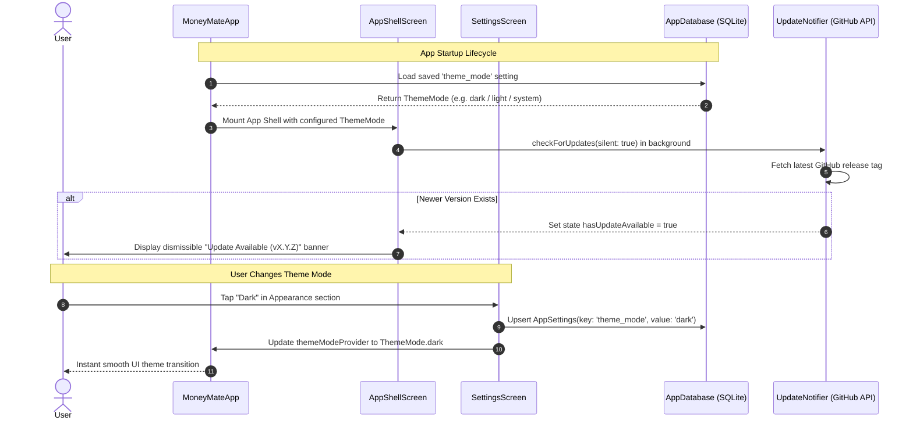

# Implementation Plan: Post-Review UX Enhancements & Fixes

> **Target Milestone / Slice:** Milestone 6: E2E Smoke & Production Polish  
> **Target Tasks / Slugs:**  
> 1. `fix/pay-cycle-date-alignment` (Date alignment: 15 Oct – 14 Nov classed as October)  
> 2. `feat/dark-mode-theme` (Dark mode option & persistence)  
> 3. `feat/tracker-month-filter` (Tracker quick-jump month/period picker)  
> 4. `feat/dashboard-month-filter` (Dashboard single-month breakdown filter)  
> 5. `feat/auto-update-prompt` (Automatic background update notification on startup)  
> **Status:** Draft  
> **Last Updated:** 2026-11-11  
> **Artifact Location:** `docs/plans/post-launch-ux-improvements-plan.md`  
> **Architecture Decision Records (ADRs):** None required (leverages existing SQLite Drift `AppSettings` key-value table, Material 3 ThemeMode, and GitHub release service).

---

## 1. Executive Summary & Objective

Following physical device testing and visual review of MoneyMate, this technical implementation plan specifies five targeted enhancements to refine core user workflows, visual accessibility, and release delivery:
1. **Date Alignment Correction:** Pay periods spanning mid-month (e.g. 15 Oct – 14 Nov) must be classed by their starting month (`2026-10` / "October 2026") rather than the end month, aligning with conventional budgeting spreadsheet practices where a mid-month paycheck funds that month's budget.
2. **Dark Mode Theme Selection:** Provide an explicit Theme Mode selector (System Default, Light, Dark) in Settings, persist preference in `AppSettings`, and reactively switch the application theme.
3. **Tracker Month Quick-Jump:** Introduce an intuitive month picker in the Tracker header allowing users to jump directly to any month across multi-year histories without tedious sequential chevron tapping.
4. **Dashboard Single-Month Filter:** Expand the Dashboard time-window selector to support single-month viewing alongside existing multi-month aggregates (3M, 6M, 1Y, All Time).
5. **Automatic Update Notifications:** Perform a non-intrusive background update check on app startup and notify the user with a dismissible banner or prompt when a new version is available on GitHub Releases.

---

## 2. Architecture & Tech Stack Alignment

- **Architecture Pattern:** Vertical Slice Architecture (`lib/features/<slice>/`) with shared domain foundations in `lib/core/`.
- **Target Layers & Slices:**
  - `lib/core/utils/` & `lib/features/importer/services/`: Pay cycle math & header parsing.
  - `lib/core/theme/` & `lib/features/settings/`: ThemeMode persistence & UI toggle.
  - `lib/features/tracker/`: Month picker modal and period navigation state.
  - `lib/features/dashboard/`: Single-month filter range and analytics aggregation.
  - `lib/features/updater/` & `lib/features/shell/`: Startup release check & in-app banner.
- **State Management:** Riverpod (`StateNotifier` / `NotifierProvider` / `StateProvider`).
- **Data & Storage Contract:** Drift SQLite (`AppSettings` table key-value pairs; `ItemEntries` period keys formatted `YYYY-MM`).
- **Project Voice & Usability Check:** Adhere strictly to `GEMINI.md` plain-language rules (no financial or technical jargon; friendly everyday terms: "Appearance", "Pay Period", "Monthly Tracker", "Insights").

---

## 3. File Matrix (Create, Modify, Delete)

| Action | File Path | Layer / Responsibility |
| :--- | :--- | :--- |
| `[M]` | `lib/core/utils/pay_cycle_service.dart` | Align pay cycle key and date ranges to start month; handle year boundary rollover. |
| `[M]` | `lib/features/importer/services/spreadsheet_parser_service.dart` | Normalize date span headers (e.g. "15 Oct - 14 Nov") to start month (`2026-10`). |
| `[M]` | `test/core/utils/pay_cycle_service_test.dart` | Unit tests verifying start-month period key calculation and date range generation. |
| `[M]` | `test/features/importer/period_header_repro_test.dart` | Tests verifying parser normalizes span headers to start month. |
| `[M]` | `lib/features/settings/state/settings_notifier.dart` | Manage theme mode preference (`system`, `light`, `dark`) with Drift persistence. |
| `[M]` | `lib/features/settings/views/settings_screen.dart` | Add Theme Mode segmented selector / tile (System, Light, Dark). |
| `[M]` | `lib/app.dart` | Connect `MoneyMateApp` to `themeModeProvider` so theme changes reflect reactively. |
| `[M]` | `test/features/settings/settings_slice_test.dart` | Unit & widget tests verifying theme mode persistence and switching. |
| `[C]` | `lib/features/tracker/views/widgets/month_picker_sheet.dart` | Bottom sheet / modal dialog displaying interactive grid of available months/years. |
| `[M]` | `lib/features/tracker/views/tracker_screen.dart` | Wire header period label tap to open `MonthPickerSheet` and dispatch `selectPeriod`. |
| `[C]` | `test/features/tracker/month_picker_test.dart` | Widget test verifying month picker opens and selects target period. |
| `[M]` | `lib/features/dashboard/models/dashboard_state.dart` | Add single-month mode or `DashboardRange.singleMonth` support to dashboard filters. |
| `[M]` | `lib/features/dashboard/services/dashboard_analytics_engine.dart` | Compute 1-month window analytics when single-month filter is active. |
| `[M]` | `lib/features/dashboard/views/dashboard_screen.dart` | Add single-month filter button / chip and period selector dropdown. |
| `[C]` | `test/features/dashboard/dashboard_month_filter_test.dart` | Test single-month analytics calculation and filtering. |
| `[M]` | `lib/features/shell/views/app_shell_screen.dart` | Trigger background update check on app launch; display non-blocking update banner when update is available. |
| `[C]` | `test/features/updater/startup_update_check_test.dart` | Unit test verifying startup update trigger and state update. |

---

## 4. Classes, Functions & Interface Signatures

### 4.1 Pay Cycle & Date Alignment (`PayCycleService`)

```dart
class PayCycleService {
  /// Returns the period key (YYYY-MM) for a given date.
  /// When day >= cycleStartDay, returns current month (YYYY-MM).
  /// When day < cycleStartDay, returns previous month (prevYear-prevMonth).
  static String getPeriodKey(DateTime date, int cycleStartDay);

  /// Returns [startDate, endDate] inclusive.
  /// Cycle starts on cycleStartDay of period month, and ends on (cycleStartDay - 1) of next month.
  static List<DateTime> getDateRange(String periodKey, int cycleStartDay);

  /// Formats date range as plain text (e.g., "15 Oct 2026 – 14 Nov 2026").
  static String formatPeriodDateSpan(String periodKey, int cycleStartDay);
}
```

### 4.2 Theme Mode State & Persistence (`ThemeModeNotifier`)

```dart
enum AppThemeSetting { system, light, dark }

final themeModeProvider = StateNotifierProvider<ThemeModeNotifier, ThemeMode>((ref) {
  final db = ref.watch(appDatabaseProvider);
  return ThemeModeNotifier(db);
});

class ThemeModeNotifier extends StateNotifier<ThemeMode> {
  ThemeModeNotifier(this._db) : super(ThemeMode.system) {
    loadSavedTheme();
  }
  final AppDatabase _db;

  Future<void> loadSavedTheme();
  Future<void> setThemeMode(ThemeMode mode);
}
```

### 4.3 Tracker Month Picker (`MonthPickerSheet`)

```dart
class MonthPickerSheet extends StatelessWidget {
  const MonthPickerSheet({
    super.key,
    required this.currentPeriodKey,
    required this.availablePeriods,
    required this.onPeriodSelected,
  });

  final String currentPeriodKey;
  final List<String> availablePeriods;
  final ValueChanged<String> onPeriodSelected;
}
```

### 4.4 Dashboard Month Range (`DashboardRange` & Analytics)

```dart
enum DashboardRange {
  singleMonth, // 1 Month
  threeMonths, // 3 Months
  sixMonths,   // 6 Months
  oneYear,     // 1 Year
  allTime,     // All Time
}

// In DashboardAnalyticsEngine:
List<PeriodSummary> computeSummariesForRange({
  required List<TrackerPeriodData> allPeriods,
  required DashboardRange range,
  required String activePeriodKey,
});
```

---

## 5. Step-by-Step Technical Execution

### Task 1: Pay Cycle Date Alignment (`fix/pay-cycle-date-alignment`)
1. **Domain Engine Update:** Ensure `PayCycleService.getPeriodKey` maps `2026-10-15` through `2026-11-14` to `2026-10`.
2. **Parser Update:** In `SpreadsheetParserService.normalizePeriodHeader`, update the date span regex parser so headers like `"15 Oct - 14 Nov"` resolve to `2026-10` by prioritizing the start month over the end month.
3. **Tests:** Update `test/core/utils/pay_cycle_service_test.dart` and `test/features/importer/period_header_repro_test.dart` to assert that 15th-to-14th cycles resolve to the starting month.

### Task 2: Dark Mode Theme Support & Persistence (`feat/dark-mode-theme`)
1. **Settings Persistence:** Define `theme_mode` key in `AppSettings` table (`system`, `light`, `dark`).
2. **Provider & App Wiring:** Convert `MoneyMateApp` in `lib/app.dart` to a `ConsumerWidget` that listens to `themeModeProvider`.
3. **Settings UI:** Add an "Appearance" section in `SettingsScreen` with a segmented button or list tile allowing the user to select between "System", "Light", and "Dark".
4. **Tests:** Write unit tests verifying that changing theme mode persists to the database and updates `ThemeMode`.

### Task 3: Tracker Month Filter & Quick Jump (`feat/tracker-month-filter`)
1. **Month Picker Modal:** Create `MonthPickerSheet` showing available years and months from existing ledger entries, with current period highlighted.
2. **Header Interaction:** Wrap the period date span header in `TrackerScreen` with a tactile press target and a calendar/dropdown icon.
3. **State Integration:** Selecting a month triggers `ref.read(trackerLedgerNotifierProvider.notifier).selectPeriod(targetKey)`.
4. **Tests:** Widget test verifying tapping the period header opens the picker and selecting a month updates the ledger view.

### Task 4: Dashboard Month Filter & Single-Month Mode (`feat/dashboard-month-filter`)
1. **Range Extension:** Add `DashboardRange.singleMonth` ("1M" / "Single Month") option to `DashboardRange`.
2. **Analytics Aggregation:** Update `DashboardAnalyticsEngine` so when `singleMonth` is selected, only the currently active period summary and category breakdowns are displayed.
3. **UI Filter Selector:** Add "1M" chip to the range selector bar in `DashboardScreen`, plus a month dropdown/picker when in 1M mode.
4. **Tests:** Unit tests verifying analytics correctly calculate single-month aggregates without throwing range errors.

### Task 5: Automatic Background Update Check & Prompt (`feat/auto-update-prompt`)
1. **Startup Check:** In `AppShellScreen.initState` or `onMount`, trigger `ref.read(updateNotifierProvider.notifier).checkForUpdates(silent: true)`.
2. **Non-Blocking In-App Banner:** If an update is detected, show a subtle banner/badge at the top of the shell with "Update Available: vX.X.X — Tap to install" or an update snackbar/dialog.
3. **Tests:** Mock GitHub release API returning a higher semver tag; verify update banner/dialog appears on app startup.

---

## 6. System & Data Flow



---

## 7. Testing & TDD Verification Hooks

| Task Slug | Test File | Test Level | Acceptance Verification (Given / When / Then) |
| :--- | :--- | :--- | :--- |
| `fix/pay-cycle-date-alignment` | `test/core/utils/pay_cycle_service_test.dart` | Unit / Logic | **Given** cycleStartDay = 15, **When** date is 15 Oct, **Then** returns '2026-10'; **When** date is 14 Nov, **Then** returns '2026-10'. |
| `fix/pay-cycle-date-alignment` | `test/features/importer/period_header_repro_test.dart` | Unit / Parser | **Given** header "15 Oct - 14 Nov", **When** normalized, **Then** resolves to '2026-10'. |
| `feat/dark-mode-theme` | `test/features/settings/theme_mode_test.dart` | Unit & Widget | **Given** default system theme, **When** user selects Dark Mode, **Then** setting is saved to DB and MaterialApp receives ThemeMode.dark. |
| `feat/tracker-month-filter` | `test/features/tracker/month_picker_test.dart` | Widget | **Given** tracker with multi-period data, **When** user taps period title, **Then** MonthPickerSheet opens and selecting a period updates view. |
| `feat/dashboard-month-filter` | `test/features/dashboard/dashboard_month_filter_test.dart` | Unit & Widget | **Given** dashboard data, **When** 1M filter is selected, **Then** only active month's metrics and breakdowns are calculated. |
| `feat/auto-update-prompt` | `test/features/updater/startup_update_check_test.dart` | Unit & Widget | **Given** newer GitHub release available, **When** app shell initializes, **Then** update notification banner is rendered. |

---

## 8. Rollout & Pull Request Strategy

Each task will be implemented sequentially on its own atomic branch, verified against `flutter test` and `flutter analyze`, and submitted as a dedicated pull request:
1. `fix/pay-cycle-date-alignment` -> PR 1 (Date alignment fix)
2. `feat/dark-mode-theme` -> PR 2 (Dark mode support)
3. `feat/tracker-month-filter` -> PR 3 (Tracker month picker)
4. `feat/dashboard-month-filter` -> PR 4 (Dashboard month filter)
5. `feat/auto-update-prompt` -> PR 5 (Automatic startup update notification)
