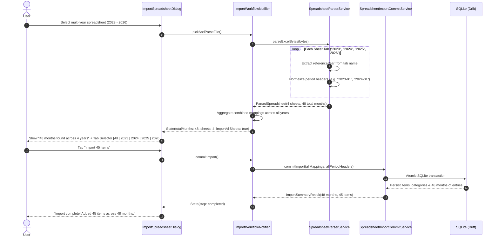

# Implementation Plan: Multi-Year Spreadsheet Tabs Patch

> **Target Patch:** Spreadsheet Multi-Year Tabs Detection & Import  
> **Target Task Slug:** `fix/spreadsheet-multi-year-tabs`  
> **Status:** Draft  
> **Last Updated:** 2026-11-04  
> **Artifact Location:** `docs/plans/spreadsheet-multi-year-tabs-patch-plan.md`

---

## 1. Executive Summary & Root Cause Analysis

### 1.1 The User Defect
When importing an Excel (`.xlsx`) workbook containing 4 annual tabs (2023, 2024, 2025, 2026; 48 total months), the importer reports:
> `"filename.xlsx • 12 months found"`
and only allows reviewing and committing the first tab.

### 1.2 Identified Root Causes
1. **Single-Sheet UI Hardcoding (`ImportSpreadsheetDialog._buildReviewView`):**
   The dialog header evaluates:
   ```dart
   final sheet = state.parsedSpreadsheet!.sheets[state.selectedSheetIndex];
   // Displays: '${sheet.periodHeaders.length} months found'
   ```
   Even though `Excel.decodeBytes` decodes all workbook sheets into `parsedSpreadsheet.sheets`, the review screen strictly calculates month counts and row mappings from `state.selectedSheetIndex` (which defaults to index `0`).
2. **Missing Tab / Sheet Selection UI:**
   Although `ImportWorkflowNotifier` defines `selectSheet(int sheetIndex)`, there is zero UI in `ImportSpreadsheetDialog` (no tabs, dropdown, or segmented button) allowing the user to view or switch between the detected annual sheets.
3. **Single-Sheet Commit Boundary in `ImportWorkflowNotifier.commitImport`:**
   The commit handler only passes `state.mappings` and `periodHeaders` of the single active sheet to `SpreadsheetImportCommitService`. There is no mechanism to import all years/tabs together in a single transaction.
4. **Missing Tab-Name Year Context in `SpreadsheetParserService`:**
   In annual spreadsheets where column headers are plain month names (e.g. `Jan`, `Feb`, `Mar`) and the year is only specified in the tab name (e.g. `2023`, `2024`), `_processSheetRows` calls `normalizePeriodHeader(val)` without passing `referenceYear`. Consequently, all tabs fall back to the current system year (`DateTime.now().year`, 2026), meaning 2023 and 2024 data would erroneously be normalized to 2026.

---

## 2. Architecture & Tech Stack Alignment

- **Architecture Pattern:** Vertical Slice Architecture under `lib/features/importer/` (models, services, state, views).
- **Target Slice:** `lib/features/importer/`
- **State Management:** Riverpod (`ImportWorkflowNotifier` / `ImportWorkflowState`).
- **Data & Storage Contract:** Drift SQLite (`AppDatabase`) atomic multi-table transaction.
- **Project Voice & Usability Check:** Plain-language, jargon-free copy conforming to `GEMINI.md`. (e.g., "All years", "48 months across 4 years", "Pick which year to review or import everything").

---

## 3. File Matrix (Create, Modify, Delete)

| Action | File Path | Layer / Responsibility |
| :--- | :--- | :--- |
| `[M]` | `lib/features/importer/services/spreadsheet_parser_service.dart` | Extract 4-digit year from sheet/tab names to supply `referenceYear` during period header normalization. |
| `[M]` | `lib/features/importer/models/import_workflow_models.dart` | Add `isAllSheetsMode` or combined sheets representation in state. |
| `[M]` | `lib/features/importer/state/import_workflow_notifier.dart` | Support combining row mappings across all sheets and switching between individual tabs and "All tabs". |
| `[M]` | `lib/features/importer/views/import_spreadsheet_dialog.dart` | Display total months across all tabs; add tab/sheet selector pill bar; support importing all sheets or single tab. |
| `[M]` | `lib/features/importer/services/spreadsheet_import_commit_service.dart` | Ensure multi-year period entries are inserted cleanly without duplicates. |
| `[C]` | `test/features/importer/multi_sheet_excel_patch_test.dart` | Unit & widget tests verifying multi-tab Excel parsing, year extraction from tab names, tab switching, and combined commit. |

---

## 4. Classes, Functions & Interface Signatures

### 4.1 Parser Updates (`SpreadsheetParserService`)

```dart
// In lib/features/importer/services/spreadsheet_parser_service.dart
ParsedSheet _processSheetRows(String sheetName, List<List<dynamic>> rows) {
  // Extract 4-digit reference year from sheet tab name if present (e.g. "2023", "Budget 2024")
  final yearMatch = RegExp(r'\b(20\d{2})\b').firstMatch(sheetName);
  final int? sheetYear = yearMatch != null ? int.parse(yearMatch.group(1)!) : null;

  // Pass referenceYear: sheetYear into normalizePeriodHeader
  ...
}
```

### 4.2 Workflow State & Notifier Updates (`ImportWorkflowState` & `ImportWorkflowNotifier`)

```dart
// In lib/features/importer/models/import_workflow_models.dart
class ImportWorkflowState {
  ...
  final bool importAllSheets; // When true, combines all sheets across workbook
  final int totalWorkbookMonths; // Total unique period months across all sheets
}

// In lib/features/importer/state/import_workflow_notifier.dart
void selectSheetMode({int? sheetIndex, bool allSheets = false});
List<ImportRowMapping> _buildCombinedMappings(List<ParsedSheet> sheets);
```

### 4.3 View Updates (`ImportSpreadsheetDialog`)

- **Header Text:**
  - If single sheet: `'${sheet.periodHeaders.length} months found'`
  - If multiple sheets (e.g. 4 sheets, 48 months): `'$totalMonths months found across ${sheets.length} years'`
- **Sheet Selector Bar:**
  - When `parsedSpreadsheet.sheets.length > 1`: Render a horizontal scrolling chip row or segmented control:
    - `[All Years (48 mos)]` (Selected by default)
    - `[2023 (12 mos)]`
    - `[2024 (12 mos)]`
    - `[2025 (12 mos)]`
    - `[2026 (12 mos)]`

---

## 5. Step-by-Step Technical Execution

### Step 5.1: Tab Name Reference Year Parsing
- In `SpreadsheetParserService._processSheetRows`:
  - Inspect `sheetName` with `RegExp(r'\b(20\d{2})\b')`.
  - Pass the matched year as `referenceYear: sheetYear` into `normalizePeriodHeader(val, referenceYear: sheetYear)`.
  - Guarantees tab "2023" normalizes column "Jan" to `2023-01`, and tab "2024" normalizes column "Jan" to `2024-01`.

### Step 5.2: Multi-Sheet Mapping Aggregation
- In `ImportWorkflowNotifier`:
  - Build `_buildCombinedMappings(List<ParsedSheet> sheets)`:
    - Merges rows across tabs that represent the same item (matching clean item name and category).
    - Unions their `periodValues` map so an item like "Rent" has values from 2023-01 through 2026-12.
    - Preserves unique items that only appear in specific years.
  - When a file is parsed, default to `allSheets: true` (if multiple sheets have period columns), or allow viewing individual sheets.

### Step 5.3: UI Review Screen Polish
- In `ImportSpreadsheetDialog`:
  - Display informative header showing the complete scope: `"my_finances.xlsx • 48 months found across 4 years"`.
  - Surface a tab switcher so the user can easily inspect individual years or review the combined list.
  - Update the "Import X items" button to accurately reflect the active selection or combined dataset.

### Step 5.4: Multi-Year Atomic Commit
- In `SpreadsheetImportCommitService`:
  - Support receiving either single-sheet period headers or multi-sheet aggregated period headers.
  - Commit all item entries within a single SQLite transaction with rollbacks on failure.

---

## 6. System & Data Flow



---

## 7. Testing & TDD Verification Hooks

| Test File | Test Case | Expected Behavior |
| :--- | :--- | :--- |
| `multi_sheet_excel_patch_test.dart` | `parses multi-year Excel workbook with tabs "2023" and "2024"` | Confirms headers in "2023" tab normalize to `2023-01..2023-12` and "2024" normalize to `2024-01..2024-12`. |
| `multi_sheet_excel_patch_test.dart` | `aggregates rows across multiple yearly sheets into unified mappings` | Confirms shared item "Rent" merges monthly entries from both years. |
| `multi_sheet_excel_patch_test.dart` | `dialog displays multi-tab count and allows switching between tabs` | Confirms widget renders "X months found across 4 years" and tab chips. |
| `multi_sheet_excel_patch_test.dart` | `commits combined multi-year entries atomically` | Confirms SQLite database contains entries spanning all 4 years. |

---

## 8. Rollout & Pull Request Strategy

1. **Branch Name:** `fix/spreadsheet-multi-year-tabs`
2. **Review Checklist:**
   - [ ] Automated reproduction test written first proving multi-sheet year normalization and tab detection.
   - [ ] Zero regression across existing single-sheet CSV and XLSX tests.
   - [ ] Plain language UI compliance: no financial/technical jargon in tab labels or dialog headers.
   - [ ] Pull request raised and reviewed via `sdlc-code-review`.
