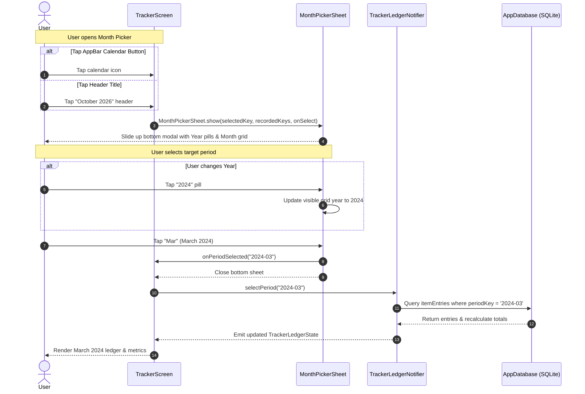

# Implementation Plan: Tracker Month Quick-Jump Filter

> **Target Milestone / Slice:** Milestone 6: Post-Review UX Polish & Production Readiness  
> **Target Task Slug:** `feat/tracker-month-filter`  
> **Status:** Draft  
> **Last Updated:** 2026-11-12  
> **Artifact Location:** `docs/plans/tracker-month-filter-plan.md`  
> **Architecture Decision Records (ADRs):** None required (pure presentation and state enhancement over existing Drift `itemEntries` table and Riverpod `TrackerLedgerNotifier`).

---

## 1. Executive Summary & Objective

In the current Tracker screen, navigating between pay cycles requires sequentially tapping `<` and `>` chevron buttons. For users with multi-year financial records (e.g., imported spreadsheets spanning 3–5 years / 36–60 months), moving across years requires dozens of sequential clicks.

This implementation plan delivers a rapid **Month Quick-Jump Picker** for the Tracker ledger:
1. **Dual Access Triggers:** Users can trigger the picker either by tapping the center period header (`"October 2026 • 15 Oct – 14 Nov"`) or via a dedicated calendar action button in the AppBar.
2. **Year Pills + 12-Month Grid Bottom Sheet (`MonthPickerSheet`):** Displays horizontal chips for available years, a 3×4 grid of all 12 months, visual indicators/badges for months that contain recorded data, and an active highlight on the current selection.
3. **Open Navigation Range + Current Period Shortcut:** Allows navigating anywhere from the earliest recorded period up to +1 year into the future (enabling forward budgeting), with a one-tap "Current Period" shortcut to instantly return to today's active cycle.

---

## 2. Architecture & Tech Stack Alignment

- **Architecture Pattern:** Vertical Slice Architecture under `lib/features/tracker/` (models, state, views, widgets).
- **Target Slice:** `lib/features/tracker/`
- **State Management:** Riverpod (`TrackerLedgerNotifier` / `trackerLedgerNotifierProvider`).
- **Data & Storage Contract:** Drift SQLite (`AppDatabase` `itemEntries` distinct `periodKey` query).
- **Design System:** Material 3 via `package:material_ui/material_ui.dart` and `CraftDecorations` (tactile pill decorations, card shadows, rounded surfaces).
- **Project Voice & Usability Check:** Adhere strictly to `GEMINI.md` plain-language conventions (e.g. "Jump to today", "Pick month", no financial jargon).

---

## 3. File Matrix (Create, Modify, Delete)

| Action | File Path | Layer / Responsibility |
| :--- | :--- | :--- |
| `[M]` | `lib/features/tracker/models/tracker_ledger_models.dart` | Add `recordedPeriodKeys` (`Set<String>`) to `TrackerLedgerState`. |
| `[M]` | `lib/features/tracker/state/tracker_ledger_notifier.dart` | Query distinct `periodKey`s from `itemEntries` on ledger load and populate `recordedPeriodKeys`. |
| `[C]` | `lib/features/tracker/views/widgets/month_picker_sheet.dart` | Tactile bottom modal sheet with Year pills, 12-month grid, data badges, and "Jump to Today" shortcut. |
| `[M]` | `lib/features/tracker/views/tracker_screen.dart` | Add calendar icon in AppBar, make period header tappable with dropdown icon, and show `MonthPickerSheet`. |
| `[C]` | `test/features/tracker/month_picker_test.dart` | Unit & widget tests verifying modal trigger, year pill switching, data indicators, period selection, and jump to today. |

---

## 4. Classes, Functions & Interface Signatures

### 4.1 State & Model (`TrackerLedgerState`)

```dart
// In lib/features/tracker/models/tracker_ledger_models.dart
class TrackerLedgerState {
  final String selectedPeriodKey;
  final int cycleStartDay;
  final String currencySymbol;
  final List<CategorySection> sections;
  final TrackerLedgerSummary summary;
  final Set<String> recordedPeriodKeys; // NEW: Set of period keys with existing data (e.g. {'2025-12', '2026-01'})
  final bool isLoading;
  final String? errorMessage;
  ...
}
```

### 4.2 Month Picker Sheet (`MonthPickerSheet`)

```dart
// In lib/features/tracker/views/widgets/month_picker_sheet.dart
class MonthPickerSheet extends StatefulWidget {
  const MonthPickerSheet({
    super.key,
    required this.selectedPeriodKey,
    required this.cycleStartDay,
    required this.recordedPeriodKeys,
    required this.onPeriodSelected,
  });

  final String selectedPeriodKey;
  final int cycleStartDay;
  final Set<String> recordedPeriodKeys;
  final ValueChanged<String> onPeriodSelected;

  static Future<void> show(
    BuildContext context, {
    required String selectedPeriodKey,
    required int cycleStartDay,
    required Set<String> recordedPeriodKeys,
    required ValueChanged<String> onPeriodSelected,
  });
}
```

### 4.3 Tracker Screen Enhancements (`TrackerScreen`)

```dart
// In lib/features/tracker/views/tracker_screen.dart
// 1. AppBar action:
IconButton(
  key: const Key('tracker_calendar_button'),
  icon: const Icon(Icons.calendar_month_rounded),
  tooltip: 'Pick pay period',
  onPressed: () => _openMonthPicker(context, ref),
)

// 2. Tappable Period Header:
GestureDetector(
  key: const Key('tracker_period_header_tap'),
  onTap: () => _openMonthPicker(context, ref),
  child: ... // Header text with subtle Icons.arrow_drop_down_rounded
)
```

---

## 5. Step-by-Step Technical Execution

### Step 5.1: Extend State with `recordedPeriodKeys`
- In `TrackerLedgerState`: Add `final Set<String> recordedPeriodKeys;` defaulting to `const {}`.
- In `TrackerLedgerNotifier.loadLedger`: Execute `selectOnly(itemEntries, distinct: true)..addColumns([itemEntries.periodKey])` to fetch all distinct period keys present in the database.
- Store the set in state so any consumer knows instantly which months have recorded transactions.

### Step 5.2: Build `MonthPickerSheet` Component
- **Year Selection:**
  - Compute range of available years: from min recorded year (or current year - 1) to max recorded year (or current year + 1).
  - Render horizontal scrolling chip list (`Wrap` or `SingleChildScrollView(scrollDirection: Axis.horizontal)`) of year pills styled with `CraftDecorations.pillDecoration`.
- **Month Grid:**
  - 3 columns × 4 rows of month buttons (`Jan` to `Dec`).
  - Active selection highlighted in primary brand color.
  - Dot indicator or subtle badge for months that are in `recordedPeriodKeys`.
  - Tapping a month constructs `YYYY-MM`, calls `onPeriodSelected(key)`, and closes the bottom sheet (`Navigator.of(context).pop()`).
- **"Jump to Current Pay Period" Action:**
  - Placed at the top or bottom of the sheet.
  - Calculates current period key from `DateTime.now()` and `cycleStartDay`.
  - Dispatches `onPeriodSelected(currentKey)` and closes sheet.

### Step 5.3: Wire Interactivity in `TrackerScreen`
- In the `AppBar`: Add calendar button `IconButton(key: Key('tracker_calendar_button'), icon: Icon(Icons.calendar_month_rounded))`.
- In the period navigation bar: Wrap center column (month title + date span) in a `GestureDetector(key: Key('tracker_period_header_tap'))` with an `Icons.keyboard_arrow_down_rounded` icon next to the title.
- Both triggers invoke `_openMonthPicker(context, ref)`.

---

## 6. System & Data Flow



---

## 7. Testing & TDD Verification Hooks

| Test File | Test Case | Acceptance Verification (Given / When / Then) |
| :--- | :--- | :--- |
| `test/features/tracker/month_picker_test.dart` | Header & AppBar trigger | **Given** TrackerScreen loaded, **When** header or calendar icon tapped, **Then** MonthPickerSheet opens. |
| `test/features/tracker/month_picker_test.dart` | Year pill switching | **Given** MonthPickerSheet open, **When** user taps a different year pill, **Then** grid updates to show that year's months. |
| `test/features/tracker/month_picker_test.dart` | Data badges | **Given** periods with entries (e.g. 2026-10), **When** sheet is viewed, **Then** Oct 2026 has a data indicator dot. |
| `test/features/tracker/month_picker_test.dart` | Selection dispatch | **Given** MonthPickerSheet open, **When** user selects "May", **Then** sheet closes and ledger loads May period. |
| `test/features/tracker/month_picker_test.dart` | Current period jump | **Given** user viewing past period, **When** "Jump to current period" tapped, **Then** ledger snaps back to today's active cycle. |

---

## 8. Rollout & Pull Request Strategy

1. **Branch Name:** `feat/tracker-month-filter`
2. **Review & Verification Gate:**
   - Execute unit & widget tests (`flutter test test/features/tracker/month_picker_test.dart`).
   - Run full regression suite (`flutter test`, all 130+ tests).
   - Verify static analysis (`flutter analyze --fatal-infos`).
3. **Pull Request:** Open PR on GitHub with detailed summary and verification logs.
